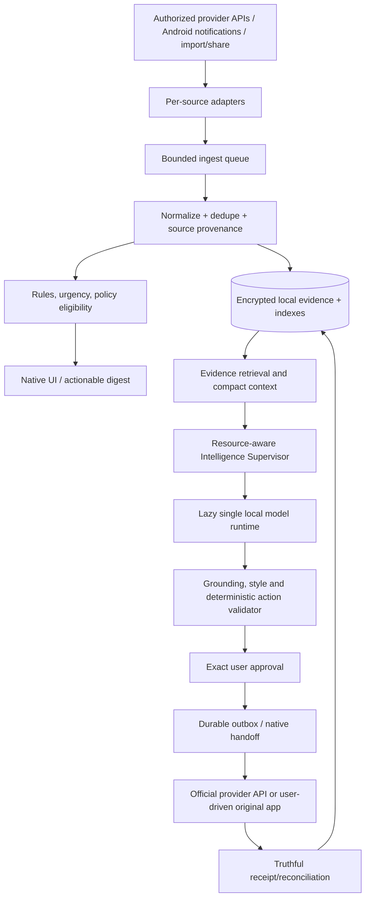

# MINI — Efficient, Reliable On-Device Intelligence Harness

**Goal:** a communication hub that stays responsive, correct and private while doing almost no idle computation. This is a proposed design, not measured implementation. The JCode ~3.1 MB incremental headless-worker benchmark pertains to JCode's **Rust coding-agent orchestration**, not to Android/iOS generative AI. MINI cannot assume a 3.1 MB local-model runtime; model weights and accelerator allocations dwarf that number.

## 1. Architecture, data plane vs control plane



**Two non-negotiable separations:** (a) observation vs verified provider history; (b) generative draft vs authorized external action. An LLM never directly holds a provider send token or invokes a network sender.

## 2. Two modes of execution

### Always-on / background-fast-path (never needs generation LLM)

User-granted event observation, cheap validation, ID extraction, minimal normalizing, encrypted persistence, rules + local priority flags, deduplication and notification/UI updates. A notification callback enqueues and returns quickly; never waits for model startup or a remote API.

### On-demand intelligence (short-lived and cancellable)

Trigger on user opening a thread, tapping 'summarize/draft', genuinely urgent user-enabled digest, or a low-cost scheduled task that respects battery/OS policy. Retrieve only needed facts, load generator if unavailable, draft, verify, release resources on inactivity/memory pressure. No default continuous summarization or every-event LLM calls.

## 3. Coordinator and task classes

| Priority | Work | Scheduling principle |
|---|---|---|
| 0 Safety | Process cancellation, revoke, approval invalidation, outbox ambiguity | Immediate; can preempt generation |
| 1 UI interactive | User-requested reply/draft/summary | P95 latency target, cancel stale requests |
| 2 Ingest | Persist and index authorized events | Bounded and loss-aware; never starve indefinitely |
| 3 Retrieval/index | Background indexing, cache refresh | Batch, coalesce and pause under load |
| 4 Optional AI | Passive labeling, style extraction | Only with consent and budgets; defer on low battery/thermal |

**Separate execution resources:** a single writer (or disciplined serialized transactional writes) for DB, bounded I/O workers, one inference supervisor, and UI render state. Don't dedicate a thread per source or conversation. Use channels/structured concurrency, cancellation and lifecycle ownership.

**Backpressure:** if queue reaches limit, never silently drop authoritative provider events without recovery state. Coalesce safely mergeable notification updates while recording loss/coverage where appropriate. A full queue must not crash the notification callback. User-triggered work gets bounded preference without starving critical ingest.

## 4. Model lifecycle state machine

```text
ABSENT -> ELIGIBILITY_CHECK -> DOWNLOADING -> VERIFYING -> INSTALLED
INSTALLED -> LOADING -> WARM -> RUNNING -> WARM
WARM -> IDLE_GRACE -> UNLOADING -> INSTALLED
LOADING/RUNNING -> CANCEL_REQUESTED -> RECOVERING or INSTALLED
ANY -> MEMORY_PRESSURE -> FLUSH_SAFE_STATE -> UNLOAD/FAIL_CLOSED
ANY -> LICENSE_OR_ARTIFACT_INVALID -> UNAVAILABLE (no silent cloud fallback)
```

**Single owner:** one process-wide model session per user profile (never one model per thread). Reject duplicate load attempts. `unload()` must be idempotent; account for native buffer lifetime and outstanding tokens. Respect app background transition, thermal status and OS jetsam/LMK behavior. All model tasks carry deadlines, cancellation tokens and resource budgets. Benchmarks must test failures inside `load`, `generate`, and `unload`.

## 5. Three-tier intelligence routing (without three loaded LLMs)

- **Tier 0 / no AI:** exact labels, calendar/event date parser, duplicate event handling, deterministic user rules, send eligibility, approval validity, static quick actions.
- **Tier 1 / single compact local generator:** draft reply, classify ambiguous intent, concise summary, limited extraction and style adaptation. One model loaded when needed.
- **Tier 2 / optional higher-quality local generator:** only on capable device and when specifically useful for difficult multi-thread or multilingual drafting. **Switch models explicitly; do not keep both in RAM.** If not available, respond with an honest lightweight experience instead of private-cloud fallback.

Device tiers are **not** tied to nominal phone RAM alone. Test available working set, runtime compatibility, sustained thermal behavior, disk, iOS process limits, user preferences and system pressure.

## 6. Incremental context and memory

### Storage entities (illustrative)

- `ObservedEvent`: provider, message/authorship, observed_at, source_timestamp?, version, content, coverage, provenance.
- `CanonicalMessage`: linked event candidates, authoritative ID where available, editions/tombstone, final evidence.
- `Conversation`: participants, channels, labels, last_known_sync and provenance coverage.
- `Fact`: typed proposition, extracted source IDs, effective time, status `confirmed|candidate|superseded|unknown|contradicted`, verification method.
- `Summary`: source range, generated_at, model/version, uncertainty, invalidation links; never overwrite originals.
- `StyleProfile`: user choice, relationship/category, recipient, confidence, bounded characteristics, example references, version.
- `ActionApproval`: exact content+recipients+route+source-version digest, expiration and approval state.

### Retrieval policy

Start **SQLite/SQLCipher and FTS** + structured fact index. Hybrid semantic search only if held-out tests demonstrate incremental recall benefit and safe local resource cost. A 270M embedding encoder is not 'free' simply because its weight file is relatively small.

```
Context budget (example, not a measured optimum):
  policy/system         200–400 tokens
  user's task           30–100
  verified fact table  100–300
  recent selected turns 200–500
  style profile         50–120
  1–3 short examples    60–250
  uncertainty/coverage  20–100
  TOTAL variable, set by quality/latency benchmark
```

Prefer **evidence-first** context to recency-only. A changed price or deadline is a first-class update; retrieve original and superseding facts as needed. Maintain links to original records and coverage. Tokenizer counts are model-dependent—use the exact tokenizer, not character guesses, in benchmarks.

## 7. Privacy protections inside the harness

- Local message content, retrieval index, derived summaries, embeddings and style exemplars are encrypted at rest; use OS-protected keys; biometric unlock optional, not mandatory.
- Model prompts/context are private, ephemeral buffers; avoid debugging logs, crash dumps, clipboard or remote observability leaks.
- Deletion invalidates summaries, retrieval cache, token caches and queued tasks. Examine whether OS backups include model and user data; users control restore/export.
- Strong separation by account and local user profile; prohibit accidental cross-account retrieval or example reuse. Recipient relationship classification must be user-correctable.
- Model download integrity (hash/signature), license/version manifests and feature gating; no hidden API call to a cloud model.
- External content may include prompt-injection instructions (e.g., 'send this immediately'). Treat all inbound messages as **data**, never instruction authority.
- Consent to **read** content is not consent to **train style**, export, or send.

## 8. Reliability strategy: Beeper/PocketPal complaints become gates

- **Missing notifications/sync:** device-specific listener availability, permission-state monitoring, health warnings, provider cursor recovery, no false claim of complete history.
- **Duplicate/misordered items:** deterministic IDs, version-aware merges and tombstones; user-visible conflict resolution when ambiguous.
- **Resource spikes/model fails:** one inference owner, controlled cold/warm behavior, corruption rollback and clear user-friendly error states.
- **Slow UI:** local cache for inbox list, minimal recompositions, paginated history, nonblocking native threads and progressive draft streaming if correct.
- **Privacy worries:** precise network disclosure, no undisclosed server conversation store, revocation/deletion and offline checks.
- **Unnatural answers:** compact style profile, task-specific prompting, actual-user edits, grounded evidence and quality eval.
- **Pricing/storage opacity:** clear model download disk/RAM disclosure, any premium connector or API charges, what syncs where and when.

## 9. Performance benchmark plan

**Baseline before inference:** cold start, first inbox render, idle PSS/RSS and CPU, notification ingest per 1,000 event fixture, 20k message local search, encryption overhead, foreground/background state transitions, process kill/recovery. Record p50/p95/p99, max queue, event loss, duplicates and correctness.

**Then add models:** exact artifact, quant level, process initial baseline, model cold load/TTFT, tokens/sec, quality, long-conversation context scaling, 15-minute sustained thermal test, app memory reclaimed after unload. Compare 1, 5, 20 min idle intervals; choose policies after data. Different phone and iPhone devices need independent numbers.

**Battery methodology:** don't infer battery solely from CPU%. Use Android Perfetto / Battery Historian / Macrobenchmark / power-profiler resources; iOS Instruments / MetricKit / Power Profiler. Report sampling duration, background/network configuration, screen on/off, brightness, temperature and repeat count. Avoid advertising absolute percent/day without controlled real-device repeated tests.

### Initial quality gates (targets, not claimed results)

- Unauthorized send: **zero** in all adversarial test cases.
- Unverified outcome treated as delivered: **zero**.
- False claim of complete history: **zero**.
- Critical price/date/recipient fabrication: **zero** in curated gating corpus.
- Event idempotency and crash recovery: no unaccounted loss in repeatable synthetic suites.
- P95 non-inference ingestion below **250 ms** as initial hypothesis under documented host/phone setup; adjust only after device testing.
- Non-model idle resource use: must be measured, then targets set against alternative solutions and OS baselines; no invented 3 MB phone target.
- Naturalness: blind comparison and style-profile match without fact regressions.

## 10. Implementation sequence / dependencies

1. Confirm native core, encrypted action store, platform testing prerequisites; establish performance probes and fake clock/model/connector harness.
2. Implement shared supervisor API in KMP with deterministic tests: one owner, cancel, priorities, bounded queue, state transitions, memory budget, no-network fallback.
3. Real Android encrypted persistence/device-restart tests, native inbox and notification listener; verify partial coverage UI.
4. Add FTS and minimal retrieval plus explicit privacy/consent style profiles.
5. Plug in first vetted model+runtime only after benchmark instrumentation; collect real device measurements.
6. Pilot one authorized provider/email integration; do not treat all social sources as equally connectable.
7. iOS-native adapters and device tests on macOS/Xcode; no Android assumptions transferred by fiat.

The next JCode prompt in this pack deliberately implements only step **2** + test infrastructure, after auditing step 1.
