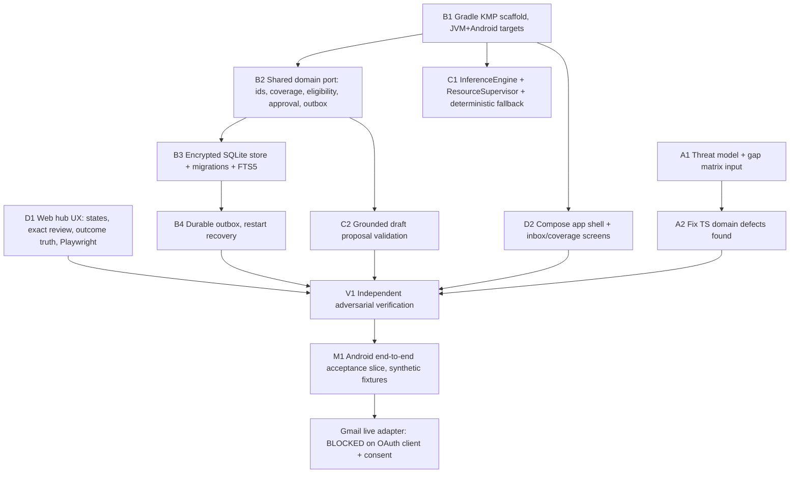

# Development plan and task graph

Coordinator-owned. Updated 2026-10-08.

## Baseline (verified at HEAD e8ea976)

- `packages/domain` (TypeScript): reference domain rules. 13 vitest tests pass.
- `apps/hub` (React/Vite): browser harness over seeded synthetic state. In-memory only, no persistence.
- `packages/publisher`: entitlement/manifest skeleton, no private-content endpoints.
- No native Android, KMP, iOS, encrypted storage, real connector or local model exists yet.
- Environment: Windows, JDK 17, Android SDK (platforms 34/35, build-tools 34/35, one system image), Gradle 8.7 cached, network available. No macOS, so iOS cannot be built or run here.

## Architecture decision for this phase

Kotlin Multiplatform is the product core (architecture section 3). The TypeScript domain stays as the
browser reference harness and executable specification until the KMP core reaches parity, then the web
harness either consumes it or is retired. New product rules land in KMP first.

## Module ownership (one owner per path; others request changes via coordinator)

| Path | Owner |
|---|---|
| `docs/SECURITY_REVIEW.md`, `docs/ARCHITECTURE_DECISIONS.md`, `docs/CONNECTOR_CAPABILITIES.md`, `packages/domain/**`, `packages/publisher/**` | Agent A, architecture and security |
| `native/settings.gradle.kts`, `native/build.gradle.kts`, `native/gradle/**`, `native/shared/**` except `intelligence` package, `native/androidApp/**` (data, connectors, platform) | Agent B, native platform and connectors |
| `native/shared/src/*/kotlin/**/intelligence/**` | Agent C, local intelligence and Resource Supervisor |
| `apps/hub/**`, Playwright harness, `native/androidApp/**/ui/**` (after B scaffold) | Agent D, product experience |
| `docs/DEVELOPMENT_PLAN.md`, `docs/IMPLEMENTATION_STATUS.md`, `docs/TEST_REPORT.md`, `docs/SETUP_AND_RUN.md`, root `README.md` | Coordinator |

## Task graph

## Milestone M1 (first integrated milestone)

The Gmail + WhatsApp observation slice from architecture section 16, on Android, against synthetic fixtures,
surviving restart. Live Gmail is blocked until an OAuth client and explicit user authorization exist.

## Current verified milestone

The KMP shared module has exact action approval/outbox contracts and an Android `SqlCipherActionStore` implementation. JVM tests cover exact payload drift, approvals, expiration, ambiguous provider outcomes, native handoff, interrupted recovery and transactional test-store behavior. Android debug compilation and APK inspection verify the SQLCipher/Keystore adapter is packaged for four ABIs. Runtime migration, key invalidation and restart qualification remain blocked because this host has no `adb`, emulator binary or connected device.

## Known external blockers

- Gmail live sync/send: needs Google Cloud OAuth client and test account consent.
- iOS: needs macOS/Xcode. Only shared-core JVM tests can run here.
- LiteRT-LM model qualification: needs model download approval and physical device measurement.
