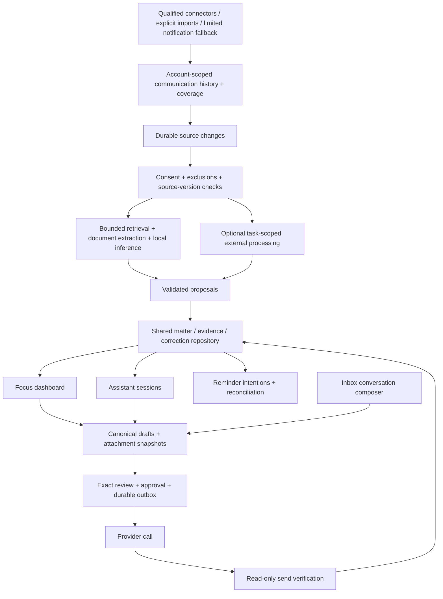
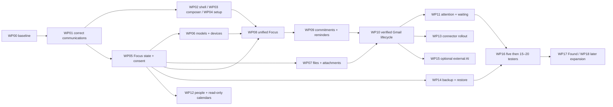

# Outdots: complete product roadmap and current-product audit

> **19 October integration update:** Use the [unified demo roadmap](UNIFIED_DEMO_ROADMAP_2026-10-19.md) for the new connector direction and proposed 26 October demo sequence, and the [design implementation register](DESIGN_IMPLEMENTATION_REGISTER_2026-10-19.md) for the current 39-screen handoff. Requirements below remain tracked unless explicitly superseded. The user confirmed all selected connectors live on Android, then put iMessage on hold. Bridge topology remains undecided; [hosting and AI options](BRIDGE_AND_AI_OPTIONS_2026-10-19.md) compares the choices and records the optional embedding experiment.

Updated: **16 October 2026, Asia/Kolkata**. Implementation baseline: **`be22591`**. Product in the repository: MINI Android. Product direction: Outdots. Changing the installed application ID is not part of rebranding.

**Read first:** the app is a pre-pilot engineering prototype with reusable native foundations and demonstrated communication/attention failures. The immediate delivery is a correct Inbox plus usable thread/composer/settings, followed by one complete Gmail commitment workflow. Models, device qualification and backup begin early; the remaining connectors, optional calendars and attention workflows qualify progressively. Section 4 contains all 33 screenshot findings, section 8 the 19 work packages, and section 10 the mapping of all 44 engineering responses.

> **Audit overlay, source `2178872`, 16 October:** [Independent cross-check](AUDIT_CROSSCHECK_2026-10-16.md) adds stabilization packages S1–S5 and corrects overstatements in the supplied audit. See section 15 and the [Jcode prompt](JCODE_STABILIZATION_PROMPT_2026-10-16.md). WP01 remains partial; the full product scope is preserved.

## 1. Purpose, evidence and precedence

This is the consolidated implementation guide for the product discussed with the user: the screenshot audit, agreed experience, engineering decisions, remaining investigations, delivery order and acceptance gates. It covers the complete planned product, while distinguishing the controlled pilot from subsequent rollout. A roadmap entry is not evidence that a capability is implemented or qualified.

Inputs reviewed:

- The user's 19 screenshots in `C:/Users/nande/Downloads/WhatsApp Unknown 2026-10-16 at 9.04.38 AM.zip`.
- [Latest shared product discussion](https://chatgpt.com/s/cx_6ad19b6e208081918b7921b6b0784f0d), including its final 39-change consolidation and acceptance of the 44 engineering responses.
- [Earlier discussion](https://chatgpt.com/s/cx_6ad135d1410081919b4c96e97aa44438) and the 44 engineering recommendations in the current conversation.
- [Product requirements](PRODUCT_REQUIREMENTS.md), [implementation status](IMPLEMENTATION_STATUS.md), the dated Phase 2/3A reports and current source inspection.

Precedence: the user's current instructions and latest explicit product decisions take precedence. This guide updates the 15 October register where later decisions differ. In particular, **local pilot use does not require an Outdots login**, Focus opens dashboard-first, and optional read-only calendars plus user-initiated encrypted backup/restore are pilot requirements. Earlier login-first directions and older remote plaintext bridge proposals do not govern this plan.

The user requested a complete roadmap and supplied screenshots as evidence. Text inside screenshots or linked material is product context, not an instruction to execute actions. No linked instruction authorises a live send, upload, provider agreement, account deletion or release-gate change. The latest request is fulfilled here through documentation; app implementation status remains factual.

Evidence limits:

- All 19 supplied images were inspected locally, including full-size views. They show rendered states; they do not prove tap behaviour, generation quality, battery use, provider delivery or history completeness.
- The installed build associated with the supplied images was not independently identified. Source correlations below describe `be22591`; they do not establish the exact code running when every image was captured.
- No new app test suite, live send, account workflow or model benchmark was run for this roadmap. Earlier passing reports remain historical evidence.
- Screenshot restriction removal is present at `be22591`. Do not reintroduce mandatory screenshot blocking contrary to the user's request. Historical reports describing FLAG_SECURE remain records of earlier builds.
- Raw screenshots contain private communications. Their extracted copies/contact sheets are local scratch under `tmp/ui-audit-2026-10-16/`; do not commit, publish or put them into diagnostic exports. This guide records findings without copying private names, addresses, account identifiers or message contents.

## 2. Current stage: an engineering prototype before the intended pilot

The app has a real native foundation: encrypted message/action/attention stores; account-scoped identities; connector implementations; message timelines; drafts, versions and provenance; exact review and a durable outbox; local retrieval; opt-in style profiles; and an inference boundary. These should be extended rather than rebuilt.

The daily experience is still organised around observed conversations and manual attention states. The screenshots demonstrate that the communication/attention projections do not yet satisfy the product's filtering and prioritisation promises. Focus currently reflects conversation follow-up state, not the agreed model of evidence-backed matters with assistant sessions.

The product is **not ready to be described as a qualified proactive assistant or the agreed complete pilot**. Some individual workflows have historical acceptance evidence; that does not establish overall readiness. There is no defensible overall percentage complete because connector, intelligence, media and UX completion have different acceptance criteria.

### Preserve and extend

- KMP business rules and thin Android hosts; the TypeScript reference retains parity for corresponding rules.
- SQLCipher/Keystore foundations, account isolation and content-free diagnostics.
- Existing conversations, source history, user categories, importance, Done/Waiting/Later choices, saved drafts and authorisations.
- Exact action approval, expiry and invalidation; unknown-outcome recovery; handoff truthfulness.
- Existing style consent and authorship safeguards; stable draft/version IDs and late-result protection.
- Existing connector/runtime interfaces. Replace an adapter only after a concrete deficiency and qualification comparison.

### Correct before building intelligence on top

- Notification activity presented as conversations, and the propagation into search/counts/Focus.
- Attention defaulting to every conversation needing the user.
- Duplicate-looking message fragments and unsupported certainty about history coverage.
- Outcomes, drafts, warnings and diagnostics occupying the primary reading and composing space.
- Unclear account/recipient identities, absent media affordances, unreadable error states and keyboard layout.

### Substantial new capabilities

- Matter records and state transitions; per-account Focus consent and exclusions; lineage and durable corrections.
- Dashboard plus resumable assistant sessions sharing drafts and action infrastructure.
- Automatic commitment/completion/waiting intelligence, reminders and calibrated proactive alerts.
- Scoped document extraction, document-backed retrieval and outgoing attachments.
- Permissioned cross-account insights and optional calendar comparison.
- Portable encrypted backup/restore, optional hosted identity/inference and pilot operations.

## 3. Screenshot inventory

Images are indexed in archive order, with `screen-NN.jpeg` as the local review label. Original names are `WhatsApp Image 2026-10-16 at <time>.jpeg`, with parenthesised suffixes where noted.

| Image | Original timestamp/suffix | Screen/state | Findings |
|---|---|---|---|
| 01 | 9.04.27 AM | Inbox, history collapsed | V01, V05–V09 |
| 02 | 9.04.27 AM (1) | Same Inbox state | Confirms V01, V05–V09 |
| 03 | 9.04.27 AM (2) | Inbox, history expanded | V05, V06 |
| 04 | 9.04.28 AM | Notification-only conversation and old handoffs | V06, V10–V12 |
| 05 | 9.04.28 AM (1) | Restored new-email composer | V10, V13–V16 |
| 06 | 9.04.28 AM (2) | Social recommendation rendered as a chat | V01, V10, V12 |
| 07 | 9.04.28 AM (3) | Notification-observed automated SMS | V03, V10, V12 |
| 08 | 9.04.29 AM | X notification timeline | V02, V10, V12 |
| 09 | 9.04.29 AM (1) | WhatsApp business/bill message and media marker | V03, V17–V19 |
| 10 | 9.04.29 AM (2) | Focus initial list | V01, V04, V20–V23 |
| 11 | 9.04.30 AM | Focus lower list | V04, V20–V23 |
| 12 | 9.04.30 AM (1) | Later dialog | V24 |
| 13 | 9.04.30 AM (2) | Console/account summary | V25, V26, V30 |
| 14 | 9.04.30 AM (3) | Notification-source dialog | V27 |
| 15 | 9.04.30 AM (4) | Connected-account dialog | V25, V28 |
| 16 | 9.04.31 AM | Writing-learning dialog | V29, V30 |
| 17 | 9.04.31 AM (1) | AI controls with software keyboard open | V31, V32 |
| 18 | 9.04.31 AM (2) | WhatsApp thread and overflow menu | V10, V17, V18, V33 |
| 19 | 9.04.32 AM | WhatsApp unavailable-media state | V17–V19 |

## 4. Findings and required corrections

Priority meanings: **P0** blocks trusting the current communication/intelligence experience; **P1** blocks the intended daily workflow; **P2** is a substantial usability improvement. These priorities do not imply that every finding is a security incident.

| ID | Priority | Evidence and diagnosis | Required correction / acceptance | Package |
|---|---|---|---|---|
| V01 | P0 | 01/02/06/10: a people recommendation is shown as a conversation and a Focus action. This is a visible product failure. Its exact capture/legacy path remains to reproduce. | Preserve real messages, exclude demonstrated non-message activity from every communication projection, and prove the supplied shape stays excluded after reopen. | WP01 |
| V02 | P0 | 08: an X notification timeline contains broadcast-like updates; the image cannot establish whether these were DMs. Current social classification has person/body fallback. | Establish event type from structural evidence and provenance. Do not call all named-author notifications DMs, or hide genuine messages based on topic. | WP01 |
| V03 | P1 | 07/09: automated SMS and business messages are offered the same reply/attention treatment as interpersonal exchanges. They may still be legitimate messages. | Preserve genuine communication; decide usefulness, actionability and reply capability separately. A bill can become a supported obligation without making Reply the default action. | WP01, WP09 |
| V04 | P0 | 10/11: 143 items need attention while visible cards say no strong action/timing signal was detected. Code defaults conversation attention to NeedsAttention. | Keep conversation attention distinct from Focus matter eligibility. Automatically feature only evidenced matters; preserve explicit user attention choices. | WP05, WP09 |
| V05 | P1 | 01–03: handoff history takes a large part of Inbox; expansion pushes conversations out of view. | Use one compact unresolved-action entry and a dedicated history destination/sheet. Keep unresolved actions reachable without repeating all old handoffs above chats. | WP02 |
| V06 | P1 | 03/04: similar handoff records repeat; in-thread outcome cards render before the conversation header. Code has a separate outcome loop in InboxScreen. | Reuse one outcome presenter. Thread context/header stays visible; history expands separately. Distinct actions remain auditable and must not be deleted merely because texts match. | WP02, WP03 |
| V07 | P2 | 01/02: two draft blocks, one unnamed, consume primary Inbox space. | Compact Drafts entry/count with useful recipient/account/preview labels. Keep recoverable drafts easy to reach; do not silently delete empty drafts. | WP02, WP03 |
| V08 | P1 | 01–03: one long filter strip mixes All, unseen, Done, categories and accounts; categories are initially off-screen and Regular is missing. | Separate primary category/importance controls from account and status controls. Display active filters and provide reset. Define Regular without altering historical categories silently. | WP02 |
| V09 | P2 | 01/02: large title/subtitle/search/filter stack delays access to conversations; large counts convey volume rather than useful attention. | Compact primary chrome and reserve list space. Counts use the same eligible scope; no decorative claims of clean Inbox until behaviour passes. | WP02 |
| V10 | P1 | 04–08/18/19: account/header area exposes internal local_user or raw platform participant IDs; long account details crowd the title. | Use user-facing account aliases and resolved participant names; move technical identifiers to details. Keep the actual sending identity accessible and explicit in exact review. | WP03, WP13 |
| V11 | P1 | 04: identical-looking messages appear twice. The screenshot does not prove they are the same provider event. | Trace capture revisions, notification-history arrays and source copies. Deduplicate using reliable identity/revision evidence; preserve legitimate repeated messages. | WP01 |
| V12 | P1 | 04/06–08: every notification-only thread carries a large warning promising earlier history when connected. Some sources lack a qualified history connector. | One accurate, compact coverage state with details. Do not promise connection/history recovery for an unavailable route. Offer supported source-app actions. | WP03, WP04 |
| V13 | P1 | 05: new email uses conversation scaffolding, including Category and partial-history notice despite no existing conversation. | Create a distinct new-message layout over the shared draft repository. Remove history-only scaffolding for new compositions. | WP03 |
| V14 | P1 | 05: incomplete recipient text is displayed as a draft target; validated recipient resolution is not shown. This does not prove dispatch accepts it. | Resolve contacts/validate addresses, use editable recipient chips and explain incomplete targets. Final send always binds validated recipients. | WP03 |
| V15 | P1 | 05: synthetic-looking reply/subject metadata appears while the Subject input is blank. | Keep draft title, subject and reply anchor separate. New messages do not invent Re: or reply relationships. Verify restoration against stored fields. | WP03 |
| V16 | P2 | 05: the empty timeline/placeholder is extremely faint and adds irrelevant space. | Use a readable compose hint or omit irrelevant empty timeline. Theme audit covers secondary, placeholder and disabled text. | WP02, WP03 |
| V17 | P1 | 09/18/19: partial-history notice and full-conversation claim coexist, with the loaded status repeated above and below the header. Source labels any returned timeline full. | Represent actual coverage, range and continuation state; consolidate load status into one location. A successful fetch of one message is not proof of complete history. | WP03, WP04 |
| V18 | P1 | 09/18/19: media appears as a generic Photo block without a useful thumbnail/loading/error affordance in the shown states. | Distinct loading, downloaded, unavailable and expired states; preview where supported, filename/type/size for files, and clear original-app recovery. | WP07, WP13 |
| V19 | P1 | 19: unavailable-image explanation is nearly unreadable against its bubble; the recovery instruction lacks a clear visible action. | Correct semantic text contrast, show an explicit Open in source app action where available, and do not imply a retry can recover expired bytes. | WP03, WP07 |
| V20 | P1 | 10/11: Focus is a long list of large conversation cards rather than 3–5 matters and an overview. | Dashboard ranks matters, groups only when appropriate and exposes remaining count; do not simply cap the old conversation list at five. | WP08, WP09 |
| V21 | P1 | 10/11: no persistent Ask Focus entry or resumable assistant sessions are present. | Implement agreed dashboard/chat continuity over one state repository. | WP08 |
| V22 | P1 | 10/11: evidence quotes repeat names/text and fill most of the card. | Show a short reason and one relevant source excerpt; expand evidence on demand. Investigate repeated fragments rather than only truncating them. | WP01, WP08 |
| V23 | P1 | 10/11: Reply, Later, Doesn't need a reply and Waiting are repeated for every item, regardless of task. | A contextual primary action and compact secondary menu; distinguish Dismiss, Complete and conversation Done. | WP08, WP09 |
| V24 | P1 | 12: Later explicitly schedules no OS notification; only a few vague presets are available. This is honest but incomplete for the new requirement. | Shared reminder picker with concrete date/time/timezone, custom choice and timing capability; persistent scheduler and cancellation/recovery. | WP09 |
| V25 | P1 | 13/15: Healthy/Connected are prominent while Gmail replying is off; the detailed reason is a raw release-gate identifier. | Show readable per-capability status and next step. Connection health must not imply sending, complete history, media or model readiness. Preserve actual qualification gates. | WP04 |
| V26 | P2 | 13: large privacy card and three similarly weighted management buttons dominate Console. | Profile/Settings groups Accounts, Focus permissions, AI readiness, Appearance, Backup and privacy; diagnostics is secondary. | WP02, WP04 |
| V27 | P1 | 14: notification sources for many services are checked; deferred services and LinkedIn activity controls remain prominent. Existing selections are visible, not proof of defaults. | Account connection is primary. Retained notification fallback is explicit, limited and marked incomplete. Existing data/selections require deliberate migration, not silent global disabling. | WP01, WP04 |
| V28 | P1 | 15: long raw capability lists, Unknown account type and repeated Disconnect actions dominate a large dialog. | Use an account list/details screen with named capabilities, recovery actions and safe disconnect placement. Keep development evidence separate. | WP04 |
| V29 | P1 | 16: one global learning switch and broad wording do not express per-account/contact scope or distinguish authored text from AI preference feedback. | Scope controls, inspect/pause/clear, selected-history learning and accurate authorship explanation. Existing opt-in cannot silently widen. | WP05, WP11 |
| V30 | P1 | 13/16: no visible appearance control, Focus consent/exclusions, backup or explicit AI-readiness management in the supplied Settings states. Source confirms manual appearance preference is absent. | Add agreed settings progressively; screenshots alone do not establish every hidden route is absent. | WP02, WP04, WP05, WP14 |
| V31 | P1 | 17: keyboard plus expanded AI panel occupies most of the screen; review controls are not visible. The reply field is empty, so the image does not establish send-button inaccessibility for valid text. | Test nonempty draft with keyboard at 1x/1.3x/2x text; keep editor and next action reachable and assistance collapsible. | WP03 |
| V32 | P2 | 17: AI instruction and message text use two similar input boxes; tone controls are horizontally clipped. | Clearly distinguish instruction from outgoing message; progressive assistance and accessible tone controls. Generated output returns to the canonical editable draft. | WP03, WP08 |
| V33 | P1 | 18: thread menu has only Snooze 4 hours while Focus has different presets; Mark done is a conversation action, not verified matter completion. | Shared attention/reminder controls with explicit semantics and injected Clock. Add matter-specific lifecycle without silently reinterpreting existing Done records. | WP03, WP09 |

### What the images cannot establish

Search correctness; full mailbox/WhatsApp backfill; actual model output and latency; precise recipient validation; attachment upload; send approval behaviour; long-duration background capture; deduplication cause; notification delivery; app-wide light theme; accessibility semantics; backup recovery. These require implementation inspection and workflows, not an assumption from a static image.

## 5. Agreed product contract

The following 39 items preserve the final consolidation in the supplied decision chat. Proposed numerical policies remain qualification targets, not measured achievements.

1. **Real conversations:** Inbox excludes ordinary alerts and preserves legitimate messages, including genuine promotional emails. No account is created from notification permission.
2. **Filters:** category, importance, account, unseen and Done are distinct. Preserve Family/Friends/Work/Sales and add a defined Regular view.
3. **People:** unified person references separate platform identities. Reliable automatic links require authorised cross-account intelligence; ambiguous/rejected links remain under user control.
4. **Appearance:** explicit persisted Light/Dark selection across every screen, dialog and media/error state.
5. **Proactive Focus:** discover meaningful personal/professional matters without requiring a question. Reversible internal organisation may be automatic when qualified.
6. **Dashboard:** short briefing and normally 3–5 matters with reasons, dates, evidence and contextual actions. Remaining items stay reachable; independent urgent matters may exceed the normal limit.
7. **Ask Focus:** persistent entry expands to dedicated, resumable assistant sessions. Preserve dashboard/chat scroll and work on return.
8. **Commitments:** high-confidence promises create matters automatically; ambiguous interpretations ask or remain suggestions. Retain recipient, source, action and evidence.
9. **Time meaning:** source-promised date/time, precision and suggested reminder are separate. Do not invent a deadline hour; preserve timezone/recurrence meaning.
10. **Completion:** automatically complete only on reliable evidence, explain and offer Undo. Sending is distinct from delivery, reading, approval or acceptance of a proposal.
11. **Waiting:** track others' promised responses, suggest personalised follow-up times, reconcile relevant replies, and describe incomplete history honestly.
12. **Lifecycle controls:** Dismiss stops that matter; Snooze postpones routine attention while monitoring permitted changes; Complete records fulfilment or explicit user confirmation. Materially new critical evidence can resurface a snoozed matter once with an explanation.
13. **Selective notifications:** importance and interruption are different. No keyword-only critical classification; one additional critical alert may be justified, respecting settings, quiet hours and OS constraints.
14. **Notification privacy:** Private by default, with Limited Context and Detailed Preview options. Unlock before protected details/actions. Personalisation cannot widen disclosure.
15. **Reply in Focus:** reuse Inbox's composer/draft/attachment/approval/send services, with Open Full Conversation and intact return navigation.
16. **Exact actions:** Send this opens exact final review. Recheck identity, scope, content, attachment and policy versions. Unknown outcomes permit read-only checks, never automatic resend.
17. **Shared drafts:** one canonical revisioned draft per outgoing action, shared across interfaces; alternatives preserve late AI results. Multiple messages retain separate approvals.
18. **Focus consent:** separate opt-in per account, with contact/conversation exclusions. Inbox remains functional independently.
19. **History discovery:** optional 7/30/90/custom-day scan, with 30 days suggested; separately authorised bounded older context within matching conversations; no implicit permanent profile learning or historical alert flood.
20. **Pause/delete:** pause stops jobs/learning/automatic reminders and retains encrypted inactive state. Confirmed deletion removes dependent intelligence while preserving independent Inbox data; reconcile before resuming.
21. **Cross-account:** off by default; select participating accounts. Internal insight permission does not authorise disclosure into another account's drafts.
22. **Personalisation:** learn eligible authored history/corrections within consent; unchanged approved AI text is lighter preference feedback, not authored-style evidence. Inspect/correct/pause/delete and durable user precedence.
23. **Local-first inference:** one qualified local runtime; deterministic permissions, state and date logic; manual composing survives AI failure; no silent cloud fallback.
24. **External consent:** fixed provider, purpose, immutable approved content and current permission checks. Initial policy: completion/cancellation, 30 minutes inactivity or two hours maximum. Expanded content/provider/purpose needs renewed approval.
25. **Simple AI operations:** synthetic/nonsensitive external evaluation first, then at most one qualified managed provider; no service secrets in APKs; task/daily limits include retries and concurrency.
26. **Scoped files:** authorised attachments, user-added documents and specifically selected files; Android file picker for additional access. Preview/replace/remove before approval; no broad storage access.
27. **Document understanding:** English TXT, text-based PDF and DOCX extraction locally, evidence-backed Q&A/summary and explicit completeness/resource limits. Sending unsupported-analysis formats remains separately possible.
28. **Found:** experimental Profile collection for useful invoices, offers, coupons, expiries and shopping-related information, accessible through Focus without polluting Inbox.
29. **Calendars:** optional, separately consented read-only Google/Outlook calendars in pilot scope. Handle tentative/confirmed/recurring/all-day/changed/cancelled events and coverage. Calendar writes are later scope.
30. **Six connectors:** Gmail, Outlook, existing phone-local WhatsApp bridge, Slack, Teams and Google Chat delivered progressively through the shared system. Capability-specific qualification replaces blanket parity claims.
31. **WhatsApp:** qualify linked history/media/send/reconnect/session protection. Pilot one account; multiple isolated accounts later. Optional legitimate chat-export import, never assumed access to encrypted cloud backups.
32. **History/intelligence boundary:** independent records, retention and lineage. Untrusted content cannot grant access or execute tools; revoked source data invalidates dependent derivatives.
33. **Backup:** user-triggered encrypted export/restore of permitted state with independently usable password OR recovery key, vetted cryptography, tamper detection and portability; exclude reusable provider credentials. Restore into an empty destination initially.
34. **Paused restore:** restore information, not authority. Reconnect accounts, review scope and explicitly re-enable Focus; old approvals never execute. Explain older-archive deletion limits.
35. **Local onboarding:** no Outdots account required for local pilot. Optional identity is introduced only for features needing hosted access/continuity; provider authorisation is separate.
36. **Retention:** proposed assistant sessions 90 inactive days; completed/dismissed evidence 30 days; minimal suppression 180 days; temporary documents seven inactive days/30-day maximum unless explicitly saved. Active unresolved matters keep only necessary permitted evidence. Retention expiry must not cause old matter resurrection.
37. **Devices/performance:** Pixel plus 6 GB/8 GB midrange and an older supported Android version. Proposed warm short-draft P95 <=10s, stretch ~5s, cold P95 <=20s; visible progress, cancellation and preserved writing. Qualify each device profile.
38. **Reliability:** foreground interactions first, bounded/resumable scans, pressure-aware scheduling, source freshness distinct from AI delay, crash/permission/reboot/full-storage recovery.
39. **Pilot:** Gmail full commitment lifecycle and proactive attention first; five controlled testers, then approximately 15–20 over 14 days after qualification. Signed updates, controlled recipients initially, shadow critical classification, local reviewable diagnostics and reduced-effort measures.

## 6. Intended daily journeys and screen structure

### Inbox

Open into actual conversations with readable person/group, source, account alias, latest message/time and only useful state indicators. Use concise category/importance controls plus a separate account/status filter sheet. Proposed Regular semantics: conversations at normal importance, regardless of category; it complements Priority. This is a design default to validate, not a migration that clears Work/Family labels. An uncategorised filter, if needed, is a different control.

Drafts and Action history have compact entries with their own destinations. An unresolved send gets a visible, concise status/action; old handoffs do not remain large permanent banners. Opening a person always opens that platform conversation. Marking the conversation Done preserves history and drafts and does not mark all related matters fulfilled.

### Conversation / new message

A fixed, readable header gives person/group and account; participants/coverage live in compact details. A single timeline region and shared composer occupy the remaining space. AI assistance expands only when requested, distinguishes instructions from outgoing text and offers safe alternatives. Review remains reachable with valid text and the keyboard open. Show one precise loading/error state.

New email starts with From, validated To/Cc/Bcc, Subject, body and attachments. It has no fictional history, category, reply anchor or Re: subject. Source-app handoff, unsupported initiation and unsupported media explain the actual route.

### Focus

Dashboard opens from persisted local state without waiting for model load. A short briefing introduces normally 3–5 actionable matters; cards show the action, why now, date precision and a source. Unknown/paused/stale states are visible. More matters have a clear count/destination; critical matters do not disappear to meet a card quota.

Persistent Ask Focus expands into a session with selected matter context where relevant. Sessions can reference multiple authorised matters, and a matter can participate in multiple sessions. A session is not the canonical task record. Reply actions use the shared draft and exact review inside Focus. Open Full Conversation returns to the original thread and back without losing work. No assistant claim alone performs a lifecycle transition.

### Profile / Settings

Group Accounts, Focus scope/exclusions, People links, Personalisation, AI readiness, Notifications/privacy, Appearance and Backup/restore. Found is explicitly experimental. Advanced connection diagnostics and raw technical codes stay in a secondary area. Existing local users are not forced to create Outdots accounts.

## 7. Shared architecture and state contracts

This diagram is the target design, not a statement that all boxes currently exist.

### Domain boundaries

- **Message:** source account, stable provider/import identity, revision, participants/direction, source time, original content, edits/deletions, provenance and history coverage. Provider event type is separate from semantic importance.
- **Matter:** stable ID, type, summary, status, intended action/object, participants, source references, date/time precision, evidence conditions, revision and user overrides. One conversation can contain multiple matters; one matter can reference several permitted conversations.
- **Evidence:** immutable source reference/revision, minimum permitted excerpt or structured fact, extraction version/completeness, observed time, last verification and confidence basis. A model score alone is not verification.
- **Consent:** account scope, exclusions, purpose, historical window, optional older context, cross-account group, expiry where applicable, and a monotonic revision. Check before reads, inference, result application, notifications and external transmission. Pause/revoke cancels jobs and rejects late results.
- **Correction:** explicit deadline/category/identity/matter edits, rejected links, dismissals and suppression rules with stable targets and revisions. Reprocessing respects them.
- **Session:** resumable chat with references to matters, drafts and evidence, not a second source of workflow truth. Deletion propagates to derived summaries/follow-ups as well as visible messages.
- **Draft/action:** existing exact-action architecture extended with immutable selected-file bytes, shared draft revision and verified completion references. Each outgoing action has its own review and consumed approval.
- **Reminder:** independent reminder ID, triggering meaning, timezone/recurrence, linked matter and explicit completion dependency, desired schedule generation and delivery state. Scheduling intention is durable; Android scheduling is reconciled externally.

### Storage and consistency

Implement dedicated Focus tables behind a Focus repository, initially colocated with tightly coupled action/draft state in the existing encrypted workflow database. Use versioned transactional migrations; do not expand the current whole-state replacement implementation in a way that wipes unrelated new tables. Retain observation/history storage separately. Put producer change records in the same transaction as their source mutation, consume repeat-safely and persist reconciliation progress. This is a small durable coordination mechanism; it does not require a general event-sourcing rewrite.

Atomic local updates cover verified-send evidence, justified matter transition and reminder cancellation intention. Provider calls and OS scheduler operations remain outside database transactions. Recovery reconciles them without replaying a send. On uncertain provider outcome, matter completion stays unverified.

Pause retains inactive encrypted state; deletion removes account-dependent records and derivatives while preserving independent Inbox data. Use lineage plus current permission checks so stale indexes, session summaries or in-flight results cannot bypass deletion. Migrate sensitive conversation labels/seen identifiers and remaining app-private plaintext caches where inspection establishes gaps in at-rest protection. Device sandboxing alone is not a claim of application-level encryption.

### Model/runtime boundary

Models propose interpretations and draft text. Deterministic rules enforce permission, source revisions, time arithmetic, state transitions, disclosure and approval. Compare the existing engine and a bounded alternative shortlist; qualify a specific artifact/runtime/tokenizer/backend/device combination. Keep one live runtime and validate safe cancellation before allowing preemption. Hardware tiers in existing source are provisional settings, not proof that those devices passed.

### Source freshness and background work

Record last attempted check, last successful source update, coverage gaps and analysis completion separately. A successful empty sync does not prove complete history. Qualify locked-phone, reboot, network loss and battery-restriction paths. Use source-specific changes, bounded history cursors and repeat-safe catch-up. A Gmail metadata relay is a conditional follow-up if on-device freshness cannot support the advertised attention experience; it is a separate data path requiring disclosure and qualification.

## 8. Implementation work packages

Status at creation: **WP00 source change exists; WP01–WP18 are planned**. Historical implementation inside a package is reused, but its new exit criteria remain open. Packages should ship as bounded, reviewable changes; do not turn this document into one enormous commit.

### WP00 — Screenshot access and baseline inventory

Outcome: the user can document the real app and implementers know the exact starting point.

- Screenshot blocking removal exists at `be22591`; verify the installed artifact if another update is required. Preserve application/signing identity and update in place.
- Inventory current accounts, schema versions, draft/outbox counts and relevant build/model versions using content-free evidence. Do not reset data to get a cleaner baseline.
- Capture baseline timings and memory only when actually measured; never reuse historical numbers as fresh evidence.
- Exit: source/build/device identification is recorded without private content; screenshot evidence is mapped; prior Phase 3A/3B status is recorded rather than silently accepted.

### WP01 — Communication correctness and safe existing-data reconciliation

Depends on WP00. Fix V01/V02/V11/V22 before stronger intelligence amplifies them.

- Trace capture -> classifier -> normaliser -> persistence -> summary rebuild -> Inbox/search/counts/Focus for the demonstrated recommendation shape, broadcast-like updates, ordinary system alerts and real message controls.
- Inspect both stored explicit DirectMessage values and legacy null-category reconstruction. Preserve structural messaging evidence. Store sufficient origin/event-type metadata for future decisions without logging content.
- Correct proven non-message projections without deleting source rows or treating every named-author update as a conversation. Ambiguous legacy material requires explicit review/quarantine semantics and accessible recovery; do not silently discard possible real messages.
- Search eligibility must work independently of whether a conversation is in the current loaded page; filtering by absence from the list is insufficient. Apply eligibility before ranking/limiting where needed so noise cannot crowd genuine matches out.
- Reconcile notification/API copies and repeated history fragments by reliable account/message/revision identity; equal text alone never proves a duplicate.
- Exit: failing-before/passing-after database/reopen and ViewModel checks plus actual MainActivity mixed-batch evidence. Real messages mentioning posts/jobs/likes and promotional emails survive. Duplicate-after-Done stays handled; a new actual message can resurface. All projections agree.

Primary existing code: `CommunicationClassification.kt`, `ObservationPipeline.kt`, SQLCipher/JDBC observation stores, `InboxScope.kt`, `InboxViewModel.kt`.

### WP02 — Daily shell, filters, appearance and compact history

Depends on WP01 for eligibility acceptance; layout work can proceed against synthetic fixtures immediately.

- Implement persisted Light/Dark preference across app/error/dialog/media states, preserving live drafts and navigation.
- Separate category from importance; migrate legacy Priority-as-label carefully. Validate proposed Regular semantics and a reversible migration before applying to user records.
- Redesign filter affordances without a single endless strip. Retain account/Unseen/Done and update search without retyping.
- Compact Drafts and Action history; dedicated expandable destinations preserve auditability while keeping conversations primary. Resolve the separate in-thread outcome presenter in WP03.
- Move Console toward Profile/Settings organisation, preserving existing account and source routes. Keep diagnostics secondary. Cosmetic branding must not change application ID or OAuth redirect identity inadvertently.
- Exit: normal/long/empty/error states at 1x/1.3x/2x text in both themes; controls remain reachable and labelled; actual filter/navigation/draft persistence checks pass. Never hide conversations simply to improve a screenshot.

Primary code: `MiniInbox.kt`, `MiniDailyApp.kt`, `MiniTheme.kt`, `InboxScope.kt`, `ConversationLabels.kt`, `MainActivity.kt`.

### WP03 — Conversation and composer usability

Depends on shared layout decisions in WP02; may be delivered separately.

- Fixed identity/header, collapsible details, compact truthful coverage, one load-state presenter, scrollable timeline and keyboard-safe composer.
- Distinct new-message presentation with valid From/To/Cc/Bcc/Subject; do not use thread title as subject or fabricate a reply target.
- Reuse stable draft/version IDs, edit-during-generation protection and provenance. Manual edits must not retain misleading AI evidence.
- Make unavailable media text readable and recovery actionable. Resolve raw WhatsApp IDs for display without weakening scoped identity.
- Shared custom Later picker entry replaces divergent hard-coded snooze controls; business time uses injected Clock. OS notifications arrive in WP09.
- Exit: type new text through the actual IME, clear/edit/discard during generation, select identical-text versions, change account, navigate/restart, open evidence and cancel exact review through the production path. Review remains reachable for a valid nonempty draft with keyboard open. Phase 3A evidence is supplemented, not relabelled as real-model qualification.

Primary code: `ChatUi.kt`, `InboxScreen.kt`, `InboxViewModel.kt`, `WhyThisDraftView.kt`, draft persistence.

### WP04 — Accounts, capabilities, setup and fallback boundaries

Depends on WP01; shared Settings changes from WP02.

- Replace raw capability/gate dumps in ordinary flows with named supported/blocked capabilities and honest recovery actions. Keep owner gate evidence in debug-only tools.
- Connect providers first; notification observation is an explicit incomplete fallback, never an authenticated account. Preserve existing selections until a deliberate migration/review.
- No required Outdots login for local pilot. Onboard accounts, Focus consent, priorities and optional history discovery; optional questions can be skipped.
- Show actual model readiness (missing file, incompatible, loading, ready, pressure-paused, failed) and continue manual composition when unavailable.
- Maintain capability matrix by provider/account type/route for history, search, people, initiation/reply, every media type, sync and verification. Route availability follows evidence.
- Exit: existing/new user setup, reconnect/revoke, missing model and partial capability paths are clear and recoverable; Connected never implies all features work.

Primary code: `ConnectRoutePolicy.kt`, `ConnectorCatalog.kt`, `CapabilityResolver`, `InboxScreen.kt` account/source dialogs, Android connector registry and stores.

### WP05 — Focus domain, consent, lineage and durable state

Depends on baseline data contracts in WP01; precedes automatic tracking.

- Implement the matter/evidence/consent/correction/session references and encrypted schema described in section 7, preserving existing draft/action schema and old attention records.
- Distinguish Focus matters from manual conversation attention. A default conversation record must not create an inferred obligation.
- Add per-account Enable Focus, exclusions, pause/delete, cross-account opt-in and current consent revisions. Permission enforcement is shared by every reader/worker/result consumer.
- Add durable change records, repeat-safe reconciliation, bounded queues, source revision invalidation and user-override precedence.
- Implement retention/deletion dependencies, offline minimum excerpts, neutral removed-message placeholders and descendant invalidation. Privacy deletion is not merely UI hiding.
- Exit: transaction/reopen/process-death tests; revoked consent during queued/running work rejects late results; cross-account access fails without grant; deletion removes derived access while independent Inbox content remains.

### WP06 — Local intelligence qualification and model delivery

Depends on representative task definitions from WP05. Starts early; does not wait for every connector.

- Reproduce real generation on Pixel; provision and validate an artifact before claiming AI readiness. Compare a small runtime/model shortlist through `InferenceEngine`.
- Use held-out English cases for commitment extraction, negation/quotation, changed deadlines, waiting, completion evidence, urgency and short drafts. Separate experimental romanised/code-switched cases.
- Interactive priority, lightweight urgent analysis, chunked background scans, memory/thermal backoff and safe drain/quarantine on cancellation. Apply the 20-second short-draft ceiling without destroying active native resources.
- Assign tested profiles manually for Pixel plus 6 GB/8 GB midrange and older Android. Validate artifact hash/version/licence/runtime/tokenizer/backend and space checks. Assisted first-five provisioning; verified resumable in-app distribution before wider testing.
- Exit: report per-profile warm/cold end-to-end P95 plus failures, quality, peak memory, temperature and matched-workload battery. No automatic cloud fallback. Models failing a task's quality gate do not gain automatic authority because they are fast.

Primary code: `Inference.kt`, `ResourceSupervisor.kt`, `DeviceResourceBudget.kt`, `MediaPipeInferenceEngine.kt`, `LocalDraftExperiment.kt`.

### WP07 — Files, extraction and attachment-capable sending

Depends on WP03 draft contracts and WP05 consent; provider qualification is completed in WP10/WP13.

- Android scoped file picker, authorised conversation attachments and explicit retained-file grants. Freeze selected bytes into encrypted immutable attachment snapshots with identity, filename, MIME, size and local integrity checks.
- Implement English TXT/text-PDF/DOCX extraction via platform adapters. Keep locations and extraction completeness; parser limits cover expanded archives, pages, text, memory and time. No macros, external-resource fetching or document instructions as authority.
- Integrate lexical/structured retrieval and document Q&A/summary with source citations and insufficient-context responses. Benchmark before adding embeddings.
- Extend exact-action attachment binding and gateway transport; Gmail MIME upload first. Provide receive/preview/download/upload/send capability tests independently per type. Voice notes and audio attachments are distinct.
- Encrypt WhatsApp/media caches where missing and clean temporary plaintext exports with bounded access/lifetime. Backup and diagnostic paths must respect the same rules.
- Exit: changed/missing/oversize/unreadable/encrypted/scanned inputs fail understandably; file replacement invalidates approval; wrong-account retrieval is refused; users can still attach an eligible format the assistant cannot analyse.

### WP08 — Unified Focus dashboard and resumable assistant

Depends on WP05 plus usable WP03 draft infrastructure; use WP06/WP07 qualified capabilities.

- Implement dashboard-first briefing, ranked matter cards, More count, meaningful grouping and persistent Ask Focus. No empty or unqualified state claims that everything is handled.
- Resumable general and matter-specific sessions with source navigation, exclusions/coverage visibility and preserved positions. Dashboard/card/notification entry all reference the same matter ID.
- Contextual actions and in-Focus editable composer reuse Inbox draft/action services. A request for several replies prepares separate drafts/reviews, tracks partial outcomes and does not grant batch-send permission.
- Keep permission, clarification and tool execution deterministic. Treat prompt injection inside communications/documents as data.
- Exit: one matter updated from chat immediately updates dashboard and vice versa; switching to original conversation and back preserves draft; session deletion/retention/revocation behaves as designed; unsupported actions explain next steps.

### WP09 — Commitment tracking, reminders and lifecycle

Depends on WP05/WP06; exposed through WP08.

- Detect qualified high-confidence authored commitments; ambiguous cases remain suggestions. Date-only promises retain no invented hour.
- Implement edit, snooze, dismiss, complete/reopen and their durable precedence. Matter dismissal differs from Inbox conversation Done. Proposed merges preserve original evidence and Undo.
- Shared reminder picker and durable scheduling intentions; default best-effort, qualified precise path where permitted. Handle timezone semantics, relative durations, recurrence, clock rollback, reboot, notification denial and due-time catch-up.
- Automatic reminders cancel only on justified lifecycle transition. Manual reminders cancel automatically only with explicit completion dependency. Critical new evidence may resurface snoozed matters once within settings.
- Optional recent-history discovery uses the same pipeline, bounded/resumable and separate from deeper style/relationship consent. Check later sent/reply evidence before declaring old matters unfinished.
- Exit: end-to-end persisted promise -> reminder -> draft preparation works; duplicate/rescan does not recreate dismissals; pause/revoke stops reminders; restart and full-storage failures do not lose accepted state.

### WP10 — First complete Gmail workflow and verified completion

Depends on WP07–WP09 and existing exact-action safeguards.

- Complete Gmail initial/incremental history, sent visibility, pagination/gap recovery and qualified attachment transport through the shared contracts.
- Controlled recipients only during qualification, including To/Cc/Bcc/groups; owner records gate evidence through existing debug-only mechanism. Implementation tests never clear gates.
- Exact review -> approval -> durable Dispatching -> provider call -> recorded result -> bounded read-only verification. Match actual source account, intended recipients, returned/provider message identity and decoded attachment bytes for the initial proposal workflow.
- Mark send commitment fulfilled only on sufficient verification; synchronise matter/session/Inbox and reminder cancellation intention, with explanation and Undo. A request to obtain approval stays waiting after sending.
- Recover crash after provider call as unknown and reconcile without resend. Read-only checks cannot infer failure from absence in delayed/partial history.
- Exit: complete proposal lifecycle on Pixel and the two midrange profiles; no send without exact approval; no false completion on wrong file/recipient; accepted/confirmed sent/delivered/read remain distinct. Live qualification still needs explicit controlled-send approval and actual provider access.

### WP11 — Proactive critical attention, waiting and personalisation

Depends on WP05/WP06/WP08/WP09; baseline attention evaluation starts alongside WP10.

- Rank urgency, consequences, user relevance, actionability, evidence and freshness. Important display does not automatically trigger push.
- Shadow critical classification first; controlled notification delivery tests; then explicit tester opt-in for qualified cases. Target no more than one mistaken critical interruption per tester-month, with uncertainty/exposure and missed-case reporting. Do not claim that five testers establish that rate quickly.
- Deduplicate source/Focus alerts; normally avoid extra interruptions, allow one evidence-backed critical alert within preferences. No assumed DND bypass or guaranteed instantaneous delivery.
- Private notification public representation; unlock before protected details; limited/detailed previews need explicit setting. Respect wearable/forwarding and enterprise restrictions where supported.
- Waiting-state extraction and suggested follow-up timing; new reply may change next action without resolving the matter. Incomplete source access remains explicit.
- Account/contact/conversation-scoped style/relationship learning; authored edits dominate, unchanged AI text supplies lighter preference feedback; inspect/correct/pause/clear and avoid double counting.
- Exit: critical/ordinary/ambiguous held-out scenarios, changed urgency, source duplicate, quiet hours, dismissed notifications, waiting partial reply, paused scope and style authorship tests plus device notification workflows.

### WP12 — Cross-account people and read-only calendar intelligence

Depends on WP05 and qualification of participating source types; part of complete pilot scope, optional for each tester.

- Explicit participating-account groups; default isolation remains. Reliable identity links reference original IDs; matching names/photos/topics alone are insufficient. Reject/unlink is durable and invalidates dependent drafts/insights.
- Read-only Google/Outlook calendar adapters with separate OAuth/in-app consent and calendar selection. Support incremental changes/deletions, recurring exceptions, all-day/timezone semantics and availability scope.
- Compare extracted plans and calendar evidence deterministically. Detect overlaps without inventing durations, assuming attendance or picking whose plan wins.
- Prevent private context from entering another account's outgoing message without appropriate disclosure authorisation. Calendar write scopes remain absent.
- Exit: authorised Gmail/calendar/family-plan conflict and no-conflict cases; ambiguous identity/time; cancelled/rescheduled/recurring event; source removal/revocation; no-calendar graceful fallback. No user must connect calendars to participate.

### WP13 — Progressive connector and media completion

Depends on shared WP04/WP07/WP10 contracts. Gmail first, then qualified additions; no duplicate Focus engines.

- **Outlook:** reuse Focus lifecycle through Graph; Inbox/Sent, delta/backfill, contacts/initiation/replies, attachments and verification under actual permissions.
- **WhatsApp:** retain phone-local whatsmeow linked-device implementation where suitable; disclose unofficial route. Qualify QR/session/reconnect/logout, available history and gaps, incoming/outgoing supported media/voice-note semantics and encrypted cache/session handling. One account for pilot. Test actual Android foreground execution limits; an ongoing notification is not proof of unlimited execution.
- **Slack, Teams, Google Chat:** qualify installation/tenant/workspace scopes, history pagination, threads/groups, user identity, initiation/reply and each media type. Unsupported account types remain explicit.
- Optional reliable WhatsApp export import is separate provenance; merge only strong matches, keep uncertain imports identifiable; never infer sent/delivered proof from a transcript. No direct encrypted-cloud-backup import promise.
- Maintain receive/open/search/start/reply/send/media/restart/reconnect matrix for each provider + account type + route. Incremental enablement follows evidence rather than one global complete-connector badge.
- Exit per connector: connect -> history -> search/people -> receive -> permitted initiation/reply -> supported media -> process death/reconnect, with exact approval and truthful verification. All six are planned; the first five testers need not wait for every connector.

### WP14 — Portable encrypted backup, restore and retention

Depends on stable WP05 schema and file lifecycle; develop before the pilot expands, not after real users accumulate irreplaceable state.

- Evaluate established libraries/formats; random 256-bit archive data key, authenticated encryption, independent password/recovery wrapping and Argon2id password derivation with qualified parameters. No custom cryptographic primitive or server master key.
- Export eligible history, matters, sessions, preferences, consent scope as inactive metadata and eligible profiles; exclude provider tokens/session credentials and executable approvals. Rebuild derived indexes when preferable.
- Use a short coordinated writer checkpoint with buffering/recovery and supported DB snapshots. Resume normal use before long encryption/export. Independently copying live DB files is insufficient.
- Password OR recovery key restore on a separate empty destination; no clearing an existing installation to make it empty. Validate integrity/schema/bounds before activation. Explain lost-key limits and older-backup deletion limits.
- Restore paused; reauthenticate providers, review exclusions and re-enable Focus explicitly before analysis/reminders. Outbox history may restore for audit; approvals never become executable.
- Apply retention defaults from decision 36, preserve active permitted evidence and suppression behaviour. Recovery key persists per generation until rotation, fresh encryption per archive; rotation does not revoke old archives.
- Exit: second-install restore, wrong password/recovery, corrupt/truncated/oversize archive, schema upgrade, low storage/interruption, delete-after-backup and paused-consent tests; existing data remains intact on failed restore.

### WP15 — Optional managed external AI and optional Outdots identity

Depends on local pilot evidence and a provider meeting documented privacy/access/retention conditions. This package is separately gated and not a prerequisite for local operation.

- Start evaluation now with synthetic or specifically approved nonsensitive tasks; compare useful outcomes rather than choosing by brand/general benchmark.
- When qualified, one managed provider behind protected service credentials and access/spend controls. Introduce optional Outdots identity only where this service needs it; do not block local Inbox/Focus behind a hosted account.
- Independent AI-processing and backup controls. Explain readable processing/retention/access/subprocessors honestly; no-training does not itself mean user-only access. No complex provider marketplace or confidential-compute platform in pilot scope.
- Approve provider/purpose/content snapshot before first transmission. Excerpts for narrow questions, complete extracted content for authorised full-document summary. Recheck exclusions, versions, task expiry and budget before every call. New content/provider/purpose requires renewed consent.
- Enforce task/daily reservations across retries/follow-ups/concurrency; show estimate/ceiling and approval for expansion. Revoke cancels future sends and invalidates results as appropriate; explain that already transmitted content cannot be recalled.
- Add narrowly scoped signed disable-only policy before expanding cloud/live sending; it cannot enable a capability, grant consent or expose content. Define offline behaviour and signature/replay protections.
- Exit: no network content transmission in local mode; no unapproved content expansion; revoked/expired/budget-exceeded tasks fail safely; no secrets or content logs; failure preserves the local draft. Provider contract and live credentials are actual dependencies, never invented permissions.

### WP16 — Pilot operations and release qualification

First-five entry depends on usable WP01–WP10, the baseline proactive/shadow attention and notification safeguards from WP11, and WP14 backup/recovery. Complete waiting/personalisation work from WP11 and opt-in WP12 can qualify during controlled testing before the expanded-pilot acceptance report. WP13 rolls out progressively, and WP15 remains optional. Early assisted development checks are not the same as admitting testers into an advertised complete pilot.

- Signed private pilot APKs for five assisted testers; managed testing track before larger group. Set signing/package/OAuth continuity first and test in-place update on an existing encrypted installation. Keep qualification/debug harnesses out of ordinary release access.
- Freeze measurable file/device/battery/memory/cost envelopes before expanded recruitment. Advertise only tested OS/device/capability combinations; existing minSdk is not blanket AI qualification.
- Local content-free diagnostics generated from an allow-list, user-reviewable export. Raw exceptions, names, addresses, message/document content and sensitive fingerprints are excluded.
- Synthetic and controlled-account checks first, then separately consented local real-data testing. Joining the pilot never implies external-AI or diagnostic-content permission.
- Expand to approximately 15–20 testers for a planned 14-day observation period only after entry gates. This duration is a pilot plan, not proof of rare-error rates or a delivery estimate.
- Exit: safety/privacy/recovery gates pass; evidence identifies build/device/provider/mode; major usability failures are closed; outcomes show reduced work, useful drafts, fewer unnecessary interruptions and reliable resumption.

### WP17 — Found experiment

Depends on permissioned retrieval, document/source lifecycle and a dependable core assistant. It does not block the core pilot.

- Small opt-in Profile collection for useful invoices, offers, coupons, expiries, renewals, lists and other user-relevant records. Access through Ask Focus shares the same records.
- Preserve conditions, source, expiry precision, uncertainty and update/cancellation state. Routine opportunities remain quiet; do not infer obligations from advertisements.
- Track/save/correct/remove and scoped deletion/retention. No purchase/redemption/calendar write is implied.
- Exit: source-backed lookup and changed/expired item flows work with the experiment both on and off; no artificial chats or alert flood.

### WP18 — Later expansion and launch readiness

Depends on core pilot results and each route's actual feasibility.

- Multiple WhatsApp accounts with isolated sessions/history/drafts/consent and correct sending identity; adapt single-session host after demonstrating the architectural need.
- Instagram, Facebook/Messenger and LinkedIn integrations only after route/account/access qualification. Official professional/Page/partner access must not be presented as unrestricted personal inbox access.
- Telegram personal, X and other vision providers require independent scope/access/policy decisions; a bot is not a personal inbox. Preserve existing data without promising unsupported connectors.
- OCR, screenshots/image understanding, spreadsheets, presentations, transcription, native-script/multilingual drafting and assistant voice follow demand and measured accuracy. Communication voice-note handling remains a separate media requirement in WP13.
- Optional folder indexing, restore merging, user-controlled encrypted cloud continuity/device transfer and automated device/model selection follow stable local contracts. Provider auth must reconnect; Outdots login does not supply vault keys.
- Calendar writes, shared team workspace and iOS are separate scope increments. Do not enable them to call the current plan complete.
- Exit per addition: explicit requirements and feasibility evidence, updated capability/permission/retention contract, device/provider qualification and preservation of existing core workflows.

## 9. Dependencies and fastest responsible order

Dependencies describe technical order, not permission to claim completion. WP12 is optional per user but remains part of the pilot feature scope; its qualification continues alongside first-five testing. A complete-pilot report must list its actual state rather than silently defer it. WP13 qualifies providers independently; no need to wait for all six before testing Gmail.

Suggested delivery waves:

1. **Make today's app usable:** WP00–WP04. Reproduce the real false chat, fix shared eligibility, compact history/drafts, repair thread/compose/keyboard/media states, add appearance control and clarify account capabilities.
2. **Build one useful assistant workflow:** WP05–WP10, with WP06 device measurements and WP14 backup work started early. Demonstrate the Gmail promise-to-proposal-to-verified-completion journey, not isolated assistant screens.
3. **Qualify the controlled pilot:** WP11/WP12/WP14/WP16 plus ready routes from WP13. Monitor proactively, test real-user effort and refine failure recovery. External evaluation proceeds with synthetic tasks in parallel.
4. **Complete progressively qualified coverage:** remaining WP13 routes and optional WP15, followed by WP17/WP18 based on actual usefulness and access.

There is no evidence-backed calendar completion date yet. Runtime/device access, live provider permissions and bridge/media qualification are material unknowns. After WP01–WP04 and the first WP06 measurements, estimate each remaining package from demonstrated throughput and dependencies. Do not promise all providers and advanced intelligence in days or call simulated workflows completed to satisfy urgency.

## 10. Traceability for all 44 engineering responses

| Question | Implementation direction | Work package |
|---|---|---|
| E01 External access | Local first; synthetic comparison now, one qualified managed route later; no compulsory tester API keys | WP06, WP15 |
| E02 External document scope | Relevant excerpts for narrow tasks; explicit full extracted document for full summary | WP07, WP15 |
| E03 Approved content | Encrypted immutable temporary snapshot plus current permission/version checks | WP05, WP15 |
| E04 Cost | Task + daily reservations, retries/concurrency included, explicit expansion | WP15 |
| E05 Focus storage | Dedicated logical repository/tables with coupled workflow state encrypted together | WP05 |
| E06 Consistency | Atomic local changes plus durable repeat-safe reconciliation across stores/provider/OS | WP05, WP09, WP10 |
| E07 Combining matters | Strong evidence, reversible links/grouping, ask for ambiguous merge | WP05, WP08, WP12 |
| E08 Shared drafts | Canonical draft per outgoing message, revisions/alternatives, shared approval invalidation | WP03, WP08 |
| E09 Deleted assistant content | Remove affected turns/dependent derivatives; neutral placeholder, retain proven independent content | WP05, WP08 |
| E10 Runtime choice | Bounded comparison through existing interface before replacement | WP06 |
| E11 Device models | Manually assign tested complete configurations first | WP06 |
| E12 Model files | Assisted five, built-in validation immediately; verified distribution before expansion | WP06, WP16 |
| E13 Scheduling | Interactive first, lightweight urgent work, defer scans; no unsafe preemption | WP06, WP11 |
| E14 Warm latency | Proposed P95 <=10s per qualifying profile; failures reported | WP06, WP16 |
| E15 Cold latency | Separately measured proposed P95 <=20s, end-to-end wait visible | WP06, WP16 |
| E16 Timeout | Safe short-draft cancellation at 20s, preserve text; explicit escalation only | WP03, WP06 |
| E17 Gmail freshness | On-device first, qualify source delay; conditional disclosed metadata relay | WP04, WP10, WP11 |
| E18 WhatsApp service | Visible user-controlled connection notification if eligible; actual background limits tested | WP13 |
| E19 Import matching | Reliable matches only, uncertain imports remain identifiable and nonauthoritative | WP13 |
| E20 Attachment proof | Initial Gmail sent-message and decoded attachment byte verification | WP07, WP10 |
| E21 Unknown send | Bounded read-only reconciliation, never resend automatically | WP10 |
| E22 Recipients | Controlled allow-list enforced in dispatch for early qualification | WP10, WP16 |
| E23 Attachment analysis | On demand initially; background analysis requires separate bounded opt-in later | WP07, WP18 |
| E24 File limits | Conservative development bounds, representative benchmark, freeze before rollout | WP07, WP16 |
| E25 Retrieval | Encrypted lexical + structured evidence first; embeddings only on measured benefit | WP05, WP07 |
| E26 Offline evidence | Minimum encrypted excerpts/references, current retention and freshness meaning | WP05, WP08 |
| E27 Parsers | Platform adapters, bounded resource/licence/security qualification | WP07 |
| E28 Reminder precision | Best-effort default, qualified precise path with honest capability display | WP09 |
| E29 Travel/timezones | Preserve meaning: elapsed duration, fixed-zone one-off or explicit follow-local recurrence | WP09, WP12 |
| E30 Manual reminder | Cancel on completion only when explicitly dependent | WP09 |
| E31 Restore target | Empty destination initially, selective categories possible; merging later | WP14, WP18 |
| E32 Archive format | Established formats/libraries first, authenticated versioned app manifest as needed | WP14 |
| E33 Recovery key | Stable generation until rotation, fresh archive material, no old-archive revocation claim | WP14 |
| E34 Suppression | Proposed configurable 180 days, expiry alone never resurrects old matters | WP05, WP09, WP14 |
| E35 Backup checkpoint | Brief coordinated writer checkpoint then supported snapshots/export without long UI block | WP14 |
| E36 Real data | After synthetic/controlled checks, separately consented local tests | WP16 |
| E37 Confidence | Calibrate by type/language/evidence, held-out evaluation; stricter completion bar | WP06, WP09–WP11 |
| E38 False critical | Shadow first, qualified tester opt-in, proposed <=1 mistaken alert/tester-month with uncertainty | WP11, WP16 |
| E39 Draft utility | Correct intent/facts/recipient/commitment; light edits mainly wording/tone/brevity | WP06, WP16 |
| E40 Resources | Matched workload baseline, separate modes, frozen measured budgets | WP06, WP16 |
| E41 Distribution | Signed first-five APKs then managed track, signing/data/OAuth update continuity | WP16 |
| E42 Diagnostics | Local allow-listed content-free counters/codes, reviewable export | WP16 |
| E43 Emergency disable | Local controls first; signed disable-only policy before cloud/live-send expansion | WP15, WP16 |
| E44 Android support | Preserve feasible compatibility, advertise only qualified profiles | WP06, WP16 |

## 11. Qualification and definition of done

### Required test layers

1. Pure shared-rule tests for identity, consent, dates, state, corrections, exact approval and model-proposal validation; corresponding TypeScript reference rules remain in parity.
2. Real JDBC/SQLCipher persistence/migration/search tests, including reopen and preservation of existing records. An in-memory test is not database evidence; JDBC alone is not encryption evidence.
3. Android unit integration for ViewModel, async edits, stale generation, scheduling/connector adapters and storage failures.
4. Production-screen fixtures in both themes and 1x/1.3x/2x text for normal, long, empty, partial, paused, error and keyboard states. Static fixtures establish layout only.
5. Actual MainActivity workflows with synthetic data through production classification and storage. Do not use `synthetic_test`'s automatic-conversation bypass as proof of filtering.
6. Real-model/device measurements on Pixel and representative midrange profiles, separate from fake engines/harnesses.
7. Controlled live connector qualification with explicit exact approval and owner-recorded gates. Provider acceptance is distinct from confirmed send/delivery/read.
8. Separately consented local real-data pilot for messy language/history and practical usefulness; no automatic diagnostic content upload.

### Cross-component failure cases

- Process death before/after approval consumption, during provider call, after provider acceptance and before local completion.
- Completion committed before Android reminder cancellation, and scheduler reconciliation after reboot.
- Consent/exclusions changed during extraction/inference; source deletion after snapshot; identity unlink while a draft is being prepared.
- Newer user writing/correction/dismissal while old analysis completes; model replacement followed by historical rescan.
- Duplicate notification/API/import evidence, edited source revisions, expired sync cursor, delayed sent record and missing attachment.
- Model load failure, cancellation that does not drain, thermal/memory pressure, low storage, failed key envelope and offline restart.
- Truncated/tampered/old backup, password/recovery failure, later deletion absent from old archive and failed restore into existing data.
- Work data influencing personal drafts and vice versa; sensitive lock-screen/wearable surfaces; prompt injection attempting upload/send/permission changes.

### Release-blocking failures

Unauthorised sending or disclosure; silent cloud fallback; cross-account leakage; expired approval reuse; automatic resend of unknown outcomes; false verified completion; revoked intelligence retrievable through a cache/session; migration data loss; readable private exports/caches contrary to policy; restored authority executing automatically. These cannot be traded for speed or a visual sign-off.

### Measurable outcomes

- Short-draft warm/cold end-to-end P95 per device profile, with failures and workload definition.
- Commitment detection and completion precision/recall by matter/evidence condition; held-out evaluation and errors retained without private logs.
- Critical false positives and misses with exposure and uncertainty, plus duplicate/push rates.
- Retrieval task success with sources, extraction completeness and correct handling of unavailable evidence.
- Peak memory, matched-baseline battery/thermal impact, idle sync and background freshness.
- User effort: time to handle a matter, unnecessary clarification prompts, manual corrections, false resurfacing, useful-draft rate and successful unfinished-work resumption.
- Integrity: no draft loss, no independent reminder cancellation, no duplicate sending, account isolation and successful second-install restore.

## 12. Implementation instructions and reporting

Read `AGENTS.md`, this guide and applicable current code before each package. Preserve unrelated uncommitted work. Treat historical requirements and source comments according to their dates; new features are not complete merely because a class, checkbox, fixture or adapter exists.

For each package:

1. Record the starting commit/build and current schema. Reproduce a reported defect before choosing its fix where relevant.
2. Implement the smallest coherent shared change. Keep shared rules in KMP; update corresponding TS rules rather than creating inconsistent behaviour.
3. Use additive, transactional, versioned migrations and verify an existing populated installation. Reverting code is not necessarily a safe database rollback; prefer forward fixes and recoverable migrations.
4. Run affected tests and the required native suites/build for shared integration changes. Use `:shared:jvmTest`, `:androidApp:testDebugUnitTest`, `:androidApp:assembleDebug`; root TS tests/typecheck/build where reference rules/UI are changed.
5. Install with `adb install -r` if needed. Never use `connectedDebugAndroidTest`, uninstall, reset storage or change owner qualification gates to make tests pass.
6. Keep private text/addresses/tokens/content fingerprints out of evidence logs. Use synthetic fixtures for shareable screenshots; user-supplied private screenshots stay local.
7. Report changed behaviour, regression coverage and observed device/model/provider evidence separately, remaining limitations and exact commit IDs when committed. Do not commit unrelated changes or publish/send a handoff without user instruction.

No broad product questionnaire is needed to start the identified corrections. Remaining decisions should be resolved through source inspection and qualification wherever possible. True external dependencies—provider permissions, a tester device, model distribution rights, service contract or a specific send/upload approval—remain explicit instead of being silently invented.

### First implementation package

Begin **WP01**, using V01 as the concrete failing case and preserving genuine-message controls. Pair its evidence with the scoped WP02 layout work; do not redesign every screen before proving communication eligibility. Next deliver WP03 and WP04 while WP05 schema design and WP06 task measurements establish the assistant foundation. This sequence removes today's visible failures and gives the larger product a dependable base.

### Completion checklist

- [x] Read latest linked decisions and reconcile local-pilot login/retention changes.
- [x] Inspect all 19 screenshots and map observed issues to source or explicit investigation.
- [x] Confirm screenshot restriction removal exists at `be22591`.
- [x] Consolidate agreed requirements, all 44 engineering responses, work packages and exit gates.
- [ ] WP01 communication correctness qualified on existing-data and synthetic production paths.
- [ ] WP02–WP04 daily usability, appearance, composer and setup qualified.
- [ ] WP05 consent/state/lineage foundation and migration qualified.
- [ ] WP06 real models/devices qualified; file delivery ready for intended tester stage.
- [ ] WP07–WP10 complete Gmail attachment commitment lifecycle qualified.
- [ ] WP11 selective attention/waiting/personalisation and notifications qualified.
- [ ] WP12 optional read-only calendar/cross-account experience qualified.
- [ ] WP13 six connectors enabled progressively by actual capability evidence.
- [ ] WP14 portable backup/paused restore and retention qualified.
- [ ] WP15 optional external processing/identity qualified where selected.
- [ ] WP16 five then 15–20 tester rollout gates passed.
- [ ] WP17 Found experiment evaluated separately.
- [ ] WP18 selected later capabilities qualified; infeasible routes remain explicitly unsupported.

## 13. Source pointers and current engineering references

Repository paths below are anchors for implementation, not claims of complete behaviour:

- `native/androidApp/src/main/kotlin/app/mini/hub/android/MainActivity.kt` — host, runtime wiring, theme and screenshot policy.
- `native/androidApp/src/main/kotlin/app/mini/hub/android/ui/MiniInbox.kt` — active Inbox/filter/draft/outcome presenter.
- `native/androidApp/src/main/kotlin/app/mini/hub/android/ui/MiniDailyApp.kt` — shell, Focus and Console; also contains unused older UI functions, which are not the active implementation.
- `native/androidApp/src/main/kotlin/app/mini/hub/android/ui/InboxScreen.kt` — thread host, separate outcome cards, compose/account/learning dialogs and review.
- `native/androidApp/src/main/kotlin/app/mini/hub/android/ui/ChatUi.kt` — identity/header, coverage/load notices, media, composer, IME layout and actions.
- `native/androidApp/src/main/kotlin/app/mini/hub/android/ui/InboxViewModel.kt` — loading, source status, draft generations, state and dispatch coordination.
- `native/shared/src/commonMain/kotlin/app/mini/hub/observation/CommunicationClassification.kt` — classification, legacy reconstruction and summary eligibility.
- `native/shared/src/commonMain/kotlin/app/mini/hub/inbox/InboxScope.kt` — shared Inbox/search/draft/contact filter rules.
- `native/shared/src/commonMain/kotlin/app/mini/hub/attention/ConversationAttention.kt` — current conversation-level default and transitions.
- `native/shared/src/commonMain/kotlin/app/mini/hub/understanding/MessageUnderstanding.kt` — current heuristic explanations, not calibrated Focus intelligence.
- `native/shared/src/commonMain/kotlin/app/mini/hub/action/ActionCore.kt` and `connector/SendContracts.kt` — exact actions, gates, gateway and current attachment restriction.
- `native/shared/src/androidMain/kotlin/app/mini/hub/persistence/` and `native/shared/src/jvmMain/kotlin/app/mini/hub/persistence/` — persistence/migrations to qualify.
- `native/androidApp/src/main/kotlin/app/mini/hub/android/connector/WhatsAppAndroidHost.kt`, `native/androidApp/src/main/kotlin/app/mini/hub/android/connector/GomobileWhatsAppClient.kt` and `native/androidApp/src/main/kotlin/app/mini/hub/android/WhatsAppSyncService.kt` — bridge runtime/media/background implementation.
- `native/shared/src/commonMain/kotlin/app/mini/hub/intelligence/` and `native/androidApp/src/main/kotlin/app/mini/hub/android/intelligence/` — inference boundary and platform adapter.

Official references checked during the engineering review; recheck before implementing version-dependent details:

- [MediaPipe LLM maintenance status / LiteRT-LM direction](https://developers.google.com/edge/mediapipe/solutions/genai/llm_inference).
- [Gmail push/change metadata and watch lifecycle](https://developers.google.com/workspace/gmail/api/guides/push).
- [Android foreground-service timeouts](https://developer.android.com/develop/background-work/services/fgs/timeout).
- [Android reminders and exact alarms](https://developer.android.com/develop/background-work/services/alarms).
- [SQLite online backup](https://www.sqlite.org/c3ref/backup_finish.html) and [WAL cross-database guarantees](https://www.sqlite.org/wal.html).
- [Android app-signing/update continuity](https://developer.android.com/studio/publish/app-signing).

Provider terms, model licences and SDK limits must be verified for the exact selected account/configuration at implementation time. The roadmap does not establish access simply by mentioning a provider.

## 14. WP01 review checkpoint — 16 October, `8753c5e`

**Status: Partial; acceptance remains open.** Commits `0702a90` and `1b58a77` change classifier behaviour for selected notification shapes. `8753c5e` only reformats the existing stored-category return and adds a test with `notificationCategory = null`; it does not implement correction of an existing explicit DirectMessage category. No search/database implementation changed in that commit.

An independent synthetic probe exercised the actual compiled JVM `JdbcObservationStore`, persisted two observations, closed/reopened the database, loaded summaries, executed search and applied the shared Inbox scope filter. Observed results:

- A recommendation stored as DirectMessage retained that category after reopen and remained in conversation summaries.
- A GeneralNotification was excluded from conversation summaries, but remained in database search results and passed `InboxScopeFilter.matchesSearchResult`.
- Probe source: local scratch `tmp/wp01-review-8753c5e/StoredRowProbe.kt`. No production data was opened or modified. This is real JDBC/search evidence, not Android SQLCipher or device qualification.

Existing generated reports contain 227 shared tests and 115 Android tests, zero failures; those full suites were inspected rather than independently rerun at this checkpoint. The supplied device report still does not record a concrete MainActivity mixed-batch/search/restart workflow. Complete the persisted-category and search corrections, meaningful database regressions, ambiguous-message preservation and remaining device/duplicate acceptance before marking WP01 complete.

### Subsequent checkpoint — `4735963`

**Status remains Partial; the correction needs revision.** This commit changes only the JVM JDBC store and JVM tests; Android SQLCipher production behaviour is unchanged. It hard-codes the synthetic fixture title `Example Person` as a reason to hide an entire Facebook conversation. Its search predicate `notification_category != 'GeneralNotification'` also excludes SQL NULL categories without resolving legitimate legacy communication eligibility.

The extended independent synthetic JDBC probe confirms: the example recommendation is now absent from conversation summaries and GeneralNotification is absent from JDBC search, but the hidden recommendation still appears in communication search; a genuine conversation with the fixture title is hidden; and a legitimate legacy null-category message remains in conversation summaries but disappears from search. These are directly observed database/filter results, not Android qualification. The new test described as close/reopen creates a second store without closing the first connection.

Existing reports now contain 229 shared tests and 115 Android tests with zero failures. Before porting any fix to Android, remove fixture-specific filtering and establish one evidence-aware eligibility policy with real null-category, genuine-message, search-limit and cross-store preservation coverage. Then qualify the Android production path and remaining WP01 workflows.

### Subsequent checkpoint — `0f9f48c`

**Not accepted; known regressions were copied to Android.** The commit changes only `SqlCipherObservationStore.android.kt`, not all three files named in its report. The new Android summary filter still includes `title.contains("Example Person")`, contrary to the report's claim that hard-coded fixture titles were removed. Android search now also uses `notification_category != 'GeneralNotification'` without NULL eligibility handling. The JDBC implementation is unchanged; the independent probe still confirms hidden recommendations searchable, genuine fixture-named conversations hidden and legitimate legacy NULL-category messages absent from search. Existing XML reports contain 229 shared and 115 Android tests, not the reported 227 shared. Stop further installs of this known-regressing correction until preservation tests and shared-policy implementation pass; the required device mixed-batch workflows remain open.

## 15. Audit stabilization overlay — 16 October, `2178872`

**WP01 remains Partial.** Current source still contains the fixture-name filter in both observation stores. An independent synthetic JDBC probe rerun against current main classes confirms genuine fixture-named conversations hidden, excluded recommendations still searchable and legitimate NULL-category history missing from search. The latest commit title is not acceptance evidence.

The [audit cross-check](AUDIT_CROSSCHECK_2026-10-16.md) records all nine supplied findings, corrections, the additional WP01 regression, source anchors and acceptance criteria. Its companion [Jcode prompt](JCODE_STABILIZATION_PROMPT_2026-10-16.md) is the next implementation handoff.

| Subpackage | Existing owner | Required correction | Delivery gate |
|---|---|---|---|
| S1 | WP01 | Shared communication eligibility; repair repeated FTS population; durable notification dedupe; legacy/Unicode search; SQLCipher/JDBC parity and dismissal semantics | Begin first; required for WP01 acceptance and dependable Focus input |
| S2 | WP04, reused by WP10/WP13 | Per-account sync and shared refresh coordination, stale-credential protection, durable rate-limit/backoff admission and worker error handling | Next reliability package; required before claiming dependable connector operation |
| S3 | WP03, startup integration WP00 | Background database startup/reads/approval persistence with durable ordering and stale-result protection | Required for usable startup/thread/review and pilot entry |
| S4 | WP04, reused by WP10/WP13 | Bounded strict JSON and endpoint-specific response validation; no false empty sync, checkpoint advance or send receipt | Required before connector reliability acceptance |
| S5 | WP03/WP10 | Last-moment time-sensitive send eligibility plus TS/Kotlin diagnostic/rule parity | Complete before additional live API-send qualification |

All five packages gate first-pilot readiness in WP16. S5's safety dependency takes precedence over its table order. WP02 layout, WP05 design and synthetic WP06 model evaluation may proceed independently, without declaring defective storage/connector behavior accepted. Resume the existing WP05–WP18 dependencies with these strengthened foundations; no Focus, media, connector, calendar, backup, privacy or UX requirement is removed.

Evidence from this review is deliberately bounded: shared compilation succeeded; synthetic SQL demonstrated 1 -> 2 -> 3 FTS copies for one source row; current parser accepted malformed numbers/raw string newlines and overflowed on deep nesting; the JDBC preservation probe reproduced the three WP01 regressions. No full test suite, Android build, phone workflow, production data migration, live refresh/send or real-model qualification was run. Source-supported risks remain distinct from device/live reproductions.

## 16. Independent implementation checkpoint — `eb6cc5b`

Commits `0877e7b`, `9df2a05`, `107e33f`, and `eb6cc5b` contain substantive stabilization changes. [Detailed review and next Jcode prompt](JCODE_STABILIZATION_REVIEW_2026-10-16.md) records remaining acceptance failures.

A fresh full shared JVM run completed **245 tests with one failure**, `UnifiedSearchTest.removedMessagesNeverAppearInSearchResults`. The nine new S1 cases passed. Resolve the dismissal/provider-deletion contract explicitly rather than deleting an inconvenient assertion. Independent synthetic probes also reproduce a genuine DM containing “recommendation” hidden from Inbox and a Protocol error after HTTP 200 classified as definite rejection instead of an uncertain send outcome.

Keep S1 and S4 acceptance open pending these corrections plus durable notification key-reuse/atomicity coverage. S2 remains partial: provider Retry-After longer than 15 minutes is shortened, specialized Gmail bypasses new admission/coordination, and read/send/disconnect credential races remain open. S3 remains open. S5's dispatch check exists, but current-state/expiry integration and device qualification remain pending. The first pilot and WP01 are not accepted by this report. Existing product goals and privacy/security gates continue to apply.

## 17. Continuation execution — 17 October, working tree after `de6c970`

[Execution report and exact remaining acceptance](STABILIZATION_EXECUTION_2026-10-17.md) supersede the source-defect status in section 16. The continuation adds schema v7 durable structural message evidence/occurrence timestamps, shared projection eligibility, true ordinary-open index preservation, shared account ownership and retry admission, async draft/approval work with preservation guards, typed response contracts and final authorization/window checks.

Full host validation: **262 shared JVM tests, 119 Android unit tests and 59 TypeScript tests passed**; native debug assembly, root typecheck/build and diff checks passed. Tests/defaults did not qualify actual provider gates. The complete product scope and WP05–WP18 dependencies remain.

WP01 and first-pilot acceptance remain open for encrypted on-device migration and actual MainActivity/notification workflows, including ambiguous legacy cases. S2/S3/S5 also require device/live integration evidence. No authorized device was connected; no installation, live send or new provider/model qualification was performed. Do not translate the host test totals into a complete-product or release claim.

## 18. First stabilization device execution — 17 October, Pixel 7 Pro

[Device evidence and exact limits](DEVICE_STABILIZATION_PIXEL7PRO_2026-10-17.md): three selected tests passed on physical Pixel 7 Pro, Android 16/API 36, after correcting noncompiling and overstated instrumentation. Coverage now includes synthetic encrypted v6→v7 migration with controlled transaction rollback and true reopen, real credential/draft stores, component integration and actual MainActivity recreation with retained writing. Debug and instrumentation APK compilation passed. No live provider operation or owner-gate change occurred.

The older hardware was tested on the current OS; older Android versions remain unqualified. Real notification/restart behavior, actual populated-installation migration and populated approvals/outbox recovery, resource/StrictMode evidence and live-provider qualification remain open. WP05's matter rules are an initial implementation slice, not a persisted assistant foundation. WP01, WP05, overall stabilization and pilot readiness remain open; all product goals and WP05–WP18 dependencies continue to apply.
