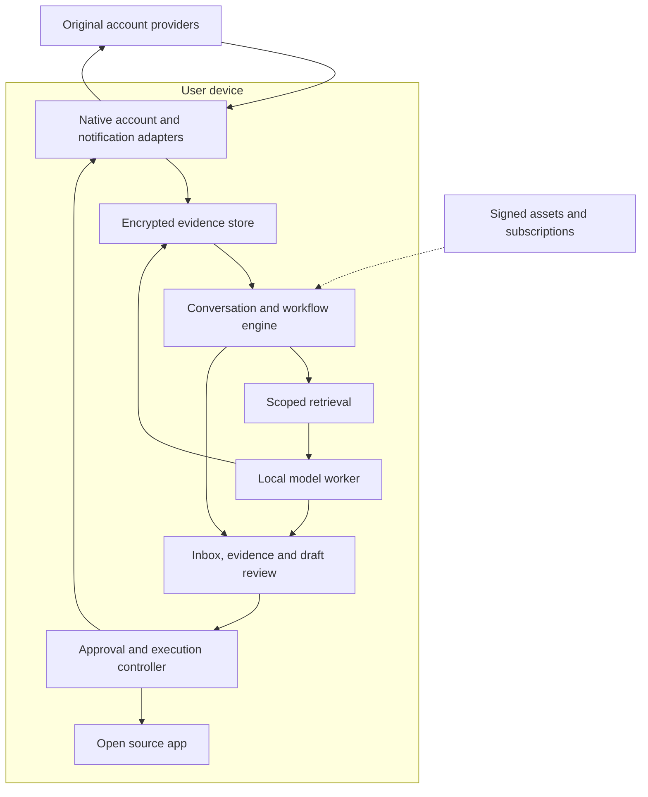
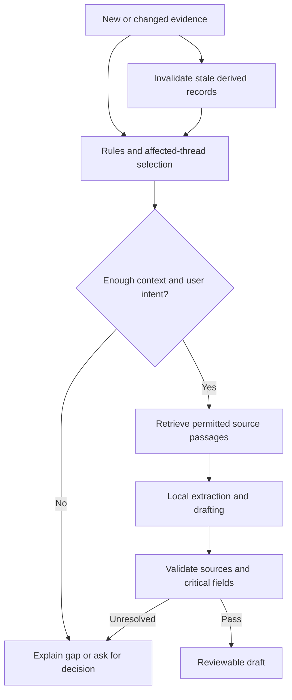
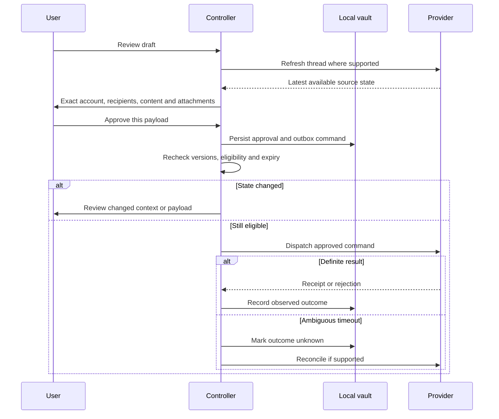

# Private AI Communication Hub — System Architecture v1.1

Prepared for Rahul Kumar Nandepu · 8 October 2026

> **Product requirements update, 15 October 2026:** [Current requirements and classified gaps](docs/PRODUCT_REQUIREMENTS.md) supersede conflicting product direction in this baseline. They preserve existing conversations and exact review, require a connector-led clean Inbox, and add Focus assistant, media, personalisation and manual Light/Dark requirements. Local models and model APIs remain candidates until pilot validation; earlier named models/runtimes are not a final choice. MINI login and optional encrypted continuity are new design work, not existing services. Current local security/account boundaries remain enforced until any replacement design is separately authorized and qualified. Recording these requirements does not authorize app implementation or private-data uploads.

Revision 1.1 adds a source-reviewed Jcode adaptation: a shared resource owner, demand-loaded inference, explicit cache/queue budgets and memory regression measurements. The local privacy contract and native/shared-core technology choices remain in force. See section 20.

**Design decision:** Build a cross-platform personal communication hub whose operational core, AI inference and personal memory live on the user's device. Use typed, provider-specific adapters for account access. Trusted application code controls every outbound action. A small publisher backend distributes updates and handles subscriptions; it does not receive private conversations or run inference.

This is an engineering design, not an implemented or benchmarked system. Platform capabilities are distinguished from proposed defaults and unqualified integration routes. The architecture carries forward the latest decision to focus on implementation, not repeat business validation.

## 1. Product contract and scope

The hub helps a person see available communications across accounts, notice important or potentially missed items, understand what changed, prepare replies, and manage follow-ups. The first intended users are founders and business owners handling substantial communication themselves. Both personal and business accounts are part of the product vision; their access capabilities differ.

Established requirements:

- One place to review supported communications, with chronological access as well as attention views.
- AI and user can assign priority; explicit user decisions take precedence.
- Local inference, assistant conversations, preferences, indexes and personal memory.
- No selling personal data and no training models on personal conversations.
- Source applications remain usable. The hub is a layer over them.
- Drafts can be prepared as information arrives when the OS and available context permit it.
- The user supplies business decisions and approves exact outgoing actions.
- Context accumulates over time, including from permitted notification observations.
- Online account requests and public research are allowed with explicit disclosure boundaries.
- Cross-platform architecture, with a consistent model quality baseline across supported phones.

Requested channel set: Gmail, Outlook, Teams, WhatsApp, Facebook/Messenger, Instagram and LinkedIn. Each is represented in the connector model. Inclusion in that model does not declare complete access or launch readiness.

**Recommended delivery sequence:** implement the shared core and Android experience first, while preserving the iOS interfaces and building an iOS email/share-input slice. This is sequencing, not a change to the cross-platform product. Do not label iOS as having Android notification coverage.

## 2. The system boundary



The model-to-store arrow means validated derived records written by the controller, not arbitrary database access by the model. The model never receives account credentials, database keys or a general network client.

There are two different sources of truth:

1. **The provider** is authoritative for its messages and provider receipts.
2. **The local vault** is authoritative for the user's hub priorities, saved preferences, assistant drafts, approvals and locally observed evidence.

Notification observations do not become authoritative provider messages merely because they have been stored. Derived summaries remain subordinate to their sources.

### Publisher services

Use one small modular backend initially, with a relational store for minimal account/entitlement records and object storage/CDN for signed model assets. There is no cloud conversation database, cloud vector database or cloud agent cluster in this design.

| Service | Allowed information | Excluded information |
|---|---|---|
| Entitlements | Pseudonymous installation/account identifier, subscription receipt, product and expiry | Connected inbox contents or message recipients |
| Release manifest | App/runtime compatibility, model and policy versions, asset hashes | Personal preferences, contacts or prompts |
| Model distribution | Public model files; ordinary request metadata such as IP address | Private context and generated replies |
| Optional diagnostics | User-authorized aggregate counters and sanitized error codes | Message text, subjects, filenames, tokens, contact names or content hashes |
| Optional Gmail wake-up relay, future | Provider email address/history identifier and device routing metadata | Message bodies; the relay does not fetch the mailbox |

The wake-up relay is outside the default build. It still exposes account/activity metadata and would require clear disclosure. Local-only content does not imply anonymous network traffic.

## 3. Components and chosen technology

Use a **modular application**, with explicit interfaces between modules. Logical boundaries do not require separate microservices.

| Component | Responsibility | Initial implementation choice |
|---|---|---|
| Shared domain core | IDs, source versions, workflow reducers, priority rules, evidence dependencies, eligibility policy, approval state | Kotlin Multiplatform; native platform interfaces |
| Android UI | Inbox, thread view, draft editing, permissions, local search | Kotlin and Jetpack Compose |
| iOS UI | Same product concepts with supported source coverage | SwiftUI with shared domain core |
| Adapter layer | Native authorization, provider requests, notification capture, app handoff | Native Kotlin/Swift; bounded typed requests |
| Local persistence | Evidence, projections, indexes, drafts, outbox and preferences | SQLCipher-backed SQLite, explicit schema migrations |
| Retrieval | Source filtering, lexical search, evidence selection | SQLite FTS5 inside the encrypted store; embeddings only after demonstrated benefit |
| Inference | Bounded extraction, summarization and drafting | Replaceable engine interface; LiteRT-LM first runtime candidate |
| Model package | Shared standard quality profile | Gemma-4-E2B package is the first candidate to qualify, not a committed winner |
| Background execution | Durable jobs, constraints, cancellation and recovery | WorkManager on Android; appropriate native background APIs on iOS |
| Resource supervisor | Own model lifecycle, memory budgets, shared resources, admission control and pressure handling | Shared policy in Kotlin Multiplatform; native memory/thermal signals and runtime-specific release hooks |
| Key storage | Protect vault wrapping keys and account secrets | Android Keystore and iOS Keychain/platform protection |
| Publisher backend | Entitlements and release manifests | A single TypeScript service with PostgreSQL; final hosting vendor remains open |

SQLCipher and FTS5 are components, not proof of end-to-end security. Verify the exact build, encrypted indexes, temporary files and database journals. [S8–S9]

Google documents LiteRT-LM across Android and iOS; its Kotlin API is stable and Swift API is early preview in the retrieved documentation. Keep runtime/platform bridges replaceable. A C++ bridge or another qualified local runtime may be needed for iOS. Same model weights and quality tests are required; a different backend must not silently introduce a weaker model. [S7]

A separate Android process under the same app UID is not a security sandbox. Prefer an isolated inference service with narrow IPC and read-only model descriptors; qualify GPU/NPU compatibility. Android documents that an isolated service has no permissions of its own. If isolation cannot support a required accelerator, record the weaker process boundary explicitly and decide before release rather than claiming isolation. [S6]

## 4. Connector architecture and realistic coverage

Every installed account has a capability snapshot. Do not infer capability from the platform logo.

```text
ConnectorCapabilities
  provider, account_type, adapter_version, policy_version
  read_history: full_within_scope | bounded | none
  inbound_visibility: complete_within_scope | partial | unknown
  outbound_visibility: complete_within_scope | partial | unknown
  read_attachments, observe_edits, observe_deletes
  send_routes: api | notification_reply | native_handoff | none
  result_visibility: provider_accepted | delivery | read | unverified
  sync_mode: cursor | polling | notifications | webhook | manual
  requires_message_body_server: boolean
  supported_platforms, required_grants, known_limitations
  qualification_status: proposed | tested | released | disabled
```

“Complete within scope” is limited to selected folders, date ranges and provider guarantees. It is not a claim that the entire account was downloaded.

| Channel/account | Planned route | Receiving/context boundary | Sending decision |
|---|---|---|---|
| Gmail | Direct provider authorization and Gmail API | Incremental mailbox sync within selected scope | Approved API send after send permission; local drafts first |
| Outlook email | Direct Microsoft Graph adapter | Qualify personal and work/school accounts separately, including tenant policy | Approved API send after route qualification |
| Teams | Separate Microsoft Graph adapter | Qualify work/school chat scopes, tenant consent and restrictions | Enable only tested action/account combinations |
| Personal WhatsApp on Android | Opt-in notification observations; user-shared context | Partial content from observation start; own replies/history may be absent | Native app handoff in pilot; notification reply is a separate experimental capability |
| Personal WhatsApp on iOS | User-mediated share/import where source app exposes it | No Android-style notification listener in this design | Native app handoff |
| WhatsApp Business Platform | Official business adapter interface | Incoming webhook architecture conflicts with strict phone-only content unless a different supported route is established | Not enabled as a complete connector under current privacy contract |
| Instagram professional / Facebook Page messaging | Provider-specific authorized APIs | Review exact retrieval, webhook and server-secret requirements | Eligibility-controlled API action only after account/route qualification |
| Personal Instagram / personal Messenger | Android observations where available; user-mediated context | No assumption of personal-inbox API parity | Native handoff unless a permitted route is separately qualified |
| LinkedIn personal messages | User-mediated context; Android observations if permitted and usable | Complete message API route unqualified | Native handoff; no browser/session scraping dependency |

Gmail read scope is restricted; send has its own scope. Selecting a label in the app is a retrieval filter, not a narrower OAuth permission. Begin applicable provider verification during the first connector work. [S3]

WhatsApp Cloud API's documented requirements include a business portfolio, WhatsApp Business Account and business number. They are not a general login for an individual's personal WhatsApp inbox. [S10]

Apple's notification extension describes receiving notifications for its own app. It is not an equivalent of Android's cross-app notification listener. This architecture therefore uses provider APIs and explicit sharing on iOS rather than promising notification parity. [S13]

### The webhook privacy conflict

WhatsApp's documented webhook route needs an internet-reachable HTTPS endpoint. Incoming message payloads can include message content. [S11]

Encrypting that payload after our server receives it does not mean our server never saw it. TLS termination at the server also does not provide phone-only plaintext access.

**Decision for this architecture:** no publisher-hosted message-body relay. The business webhook adapter remains disabled unless a provider-supported route fits the existing privacy requirement. A customer-hosted bridge would be a different deployment model, with content on another machine; it is not silently included as a solution to phone-only processing.

This leaves a concrete limitation: the initial design cannot offer complete, continuously synchronized WhatsApp Business Cloud conversations while also claiming that all additional processing happens only on the phone. Android notification observations remain a separate partial route and do not resolve that conflict.

## 5. Ingestion, sync and conversation reconstruction

### Full provider adapter

1. Authenticate with the original provider using a supported native/public-client flow. Keep tokens inside the adapter's protected credential store.
2. Establish the selected scope and a provider checkpoint. Perform bounded initial synchronization with the provider's documented race-handling procedure.
3. Convert changes to canonical events while retaining source IDs, original timestamps and revisions.
4. In one local transaction, upsert evidence, advance the relevant durable cursor, update affected projections and queue analysis jobs. Never advance the cursor past evidence that was not committed.
5. Publish changed views to the UI. AI work happens after the transaction and does not block ingestion.
6. Reconcile changes on foreground entry, eligible scheduled work and permitted wake-up hints.

Gmail history cursors can expire. Its documented response for a history ID outside the available range is HTTP 404 and a new full synchronization. Our recovery covers the declared retained scope and marks coverage uncertain until it is reconciled. [S2]

Use per-account bounded concurrency and rate-limit backoff. Cursor and revision values are opaque; do not assume they are sequential integers unless the provider guarantees it. An expired credential pauses that adapter without disabling other accounts.

### Notification observation adapter

Only allowlisted applications are processed, following an explicit notification-access grant. Filter unrelated packages before persistence. Default exclusions include authentication/OTP notifications and apps the user has not selected. Do not use this route to bypass a provider's data-use restrictions.

The listener copies the minimum permitted payload quickly and schedules parsing away from its callback. It does not load the LLM in the callback. Android documents work-profile restrictions and main-thread callback behavior; permission does not grant access to app databases. [S1]

Store a notification observation separately from a provider message:

```text
Observation
  local_id, package_id, platform_user_scope
  notification_key, observation_revision
  observed_at, source_timestamp_if_present
  conversation_hint, sender_hint, text_fragments
  content_available, truncation_state, grouping_state
  correlation_confidence, source_action_availability
```

A notification update can contain old lines plus one new line. It can also replace a preview or summarize a group. Compare revisions and match evidence within the same source context. A repeated text such as “OK” is not enough to deduplicate two real messages.

Persist stable provider IDs when available. Otherwise use a local observation identity and tentative correlations. Notification keys are not guaranteed permanent conversation IDs. Unknown account identity in a multi-account source app must remain unknown; it is unsafe to guess the sending account.

Notification removal is not proof of reply, reading, resolution or source-message deletion. Dismissal, grouping and app behavior can all remove a notification.

### Growing memory from notification 1 to notification 100

Yes, the app can accumulate useful context. Each observation adds evidence, and the controller can update a sourced summary and potential follow-ups. The record must still preserve missing history and potentially missing outgoing messages.

Example: the app observes a customer request, a revised price and a later “please confirm.” It can recall the request and revision. If Rahul replied in the original app without an observable outgoing event, it cannot conclude that he has not replied. The UI says “May need a reply — outgoing activity not available” and offers “Handled elsewhere.”

Marking handled changes the hub workflow. It does not fabricate a provider message or delivery receipt. A model summary must never fill the missing middle with invented conversation.

## 6. Local data model

Use relational tables plus explicit dependency edges. A graph database is unnecessary initially. IDs are always scoped by provider and account.

| Record | Key fields and purpose |
|---|---|
| Account | Local account ID, provider account ID, account type, context compartment, grants and credential reference |
| ConnectorState | Capability snapshot, cursor, last successful check, next retry, failure code, qualification state |
| Coverage | History start/end, inbound/outbound visibility, known gaps, edit/delete visibility and stale state |
| SourceEvent | Provider event ID or local observation ID, adapter version, event time and ingestion time |
| MessageRevision | Account/thread/message IDs, sender and participant IDs, direction, content, revision and tombstone |
| Observation | Partial source fragments and tentative conversation correlation |
| Conversation | Source thread identity, participants, local revision, coverage and selected context compartment |
| IdentityLink | Confirmed relationship between channel identities; evidence and reversibility |
| Attachment | Local encrypted reference, type, size, extraction status, limits and source version |
| EvidenceRef | Source record/version and text span or document page; used by every derived claim |
| FactAssertion | Subject, claim, evidence, confirmation state, valid-from/expiry and superseded-by link |
| StylePreference | Context scope, preference, selected examples, user confirmation and version |
| ActionItem | Request/follow-up candidate, evidence, inferred/user-confirmed state, due time and snooze |
| PriorityOverride | User choice, scope, creation time and explicit reset behavior |
| Summary | Source versions, text, coverage warning and invalidation state |
| Draft | Exact text/attachments, account/recipients, intent version, evidence revisions and status |
| Approval | One-use authorization bound to exact payload, source state, route and expiry |
| OutboxCommand | Durable command ID, payload digest, execution state, retry/reconciliation policy |
| ActionReceipt | Provider response or native handoff result with explicit confidence/status |
| Job | Kind, priority, input revisions, budget, checkpoint and cancellation state |
| DependencyEdge | Derived record to evidence version; enables invalidation and deletion |
| DeletionTombstone | Prevents deleted local content from silently reappearing during later sync |

A source deletion invalidates dependent summaries, indexes, drafts and memory. An edit invalidates only records that depend on the changed revision. Recompute projections from retained evidence; there is no requirement to retain every raw payload indefinitely.

### Identity linking

Two “Rahul” display names are not one person by default. Link using authoritative identifiers or user confirmation. Even after linking, preserve separate channel threads and outbound routes. Identity linkage enables scoped retrieval; it does not automatically permit work-to-personal disclosure.

### Memory classes

1. **Observed evidence:** what a source actually exposed.
2. **Derived state:** summaries, suggested requests and unresolved questions; rebuildable and revisable.
3. **Confirmed memory:** facts and preferences the user deliberately saves or confirms.

A quote is not a user preference. An approved draft is not automatic permission to make every sentence permanent memory. Style examples should come from user-authored material selected for that context. Do not train model weights on these records.

Keep work and personal compartments separate in retrieval by default. An aggregate home view can show both without mixing their content in a draft. Cross-context retrieval requires a deliberate task scope or selection.

## 7. Workflow, priority and reply eligibility

These are independent dimensions. Do not overload one “status” field.

| Dimension | Examples | Authority |
|---|---|---|
| Workflow | Needs review, Needs decision, Draft ready, Waiting, Snoozed, Done | User decisions plus clearly labeled AI suggestions |
| Priority | High, Normal, Low; explicit user override | User override wins; deterministic ranking uses extracted signals |
| Coverage | Current within scope, Partial, Stale, Unknown | Adapter and sync evidence |
| Reply eligibility | Active, Expiring, Expired, Unknown, Not applicable | Provider-specific deterministic policy |

Opening a thread is not automatically “done.” A new actionable message can reopen a completed thread, with an explanation. The user can dismiss an inferred request without deleting its source.

Priority inputs include explicit user choices, selected important contacts, unanswered-request evidence, user deadlines, elapsed time and confidence. AI extracts candidate signals; it cannot hide an item from All. API-window expiry is a secondary operational signal, not an automatic declaration that a message is important.

### Reply Eligibility & Deadline Engine

This module accepts a connector capability snapshot, authoritative qualifying events, current grants, route, policy version and current time. It returns:

```text
ReplyEligibility
  window_state: ACTIVE | EXPIRING | EXPIRED | UNKNOWN | NOT_APPLICABLE
  qualifying_event_ref, closes_at, evaluated_at
  route: FREEFORM_API | APPROVED_TEMPLATE | PERMITTED_EXCEPTION
         | NOTIFICATION_REPLY | NATIVE_HANDOFF | UNAVAILABLE
  eligible_now, reason_code, policy_version, needs_recheck
```

For a provider policy that uses a 24-hour customer window, derive the closing time from the **qualifying customer event**, not the most recent arbitrary thread activity. Our outgoing message, a read receipt or opening the hub does not automatically restart it.

Meta's published WhatsApp material distinguishes the customer support window from other conversation/session concepts and describes template requirements outside the customer window. Exact policy/account eligibility must be rechecked when implementing the adapter; the retrieved indexed documentation is not a universal current rule for all Meta products. [S12]

| State | Product behavior |
|---|---|
| Active | Prepare an evidence-grounded draft if the workflow needs one; permit only currently allowed routes |
| Expiring | Show time remaining for relevant unresolved items; optional digest/reminder |
| Expired | Block the now-ineligible freeform API route; offer a permitted alternative or source-app handoff |
| Unknown | Do not assume permission; refresh qualifying evidence or use an allowed handoff |
| Not applicable | Do not invent a deadline for a route such as ordinary email |

The suggested four-hour amber threshold is a configurable product reminder setting, not a Meta rule. Platform-specific exceptions must have their own eligibility tests. Do not apply a WhatsApp template rule to Instagram or Messenger, and do not assume that human approval makes every exception usable for AI-generated content.

At the actual send attempt, recompute against the newest available state, account grants and policy. Store timestamps in UTC; display user-local time. If clock skew or missing qualifying events make the result unreliable, return Unknown. A native handoff does not override the source app's own rules.

## 8. Local AI and evidence pipeline



Use one loaded generative model with bounded sequential tasks initially. Ingestion, date arithmetic, policy checks and sending are ordinary code. Multiple “agents” are not needed for these operations.

The controller performs:

1. Select a thread and allowed context compartment.
2. Retrieve recent raw messages, relevant earlier evidence, confirmed memory and applicable style examples.
3. Construct a token-bounded context bundle with provenance and missing-context labels.
4. Ask for structured extraction: requests, proposed deadlines, explicit facts, contradictions and missing decisions.
5. Validate that evidence IDs exist and values such as dates, amounts and attachments match available evidence or user input.
6. Draft only within the user's stated position. Unresolved business decisions become questions or explicit placeholders.
7. Validate the draft and save it with the exact context/intent versions.

Model confidence is not a calibrated probability. A source citation proves where a claim came from, not that the source is true. Store disputed or self-contradictory facts accordingly. Semantic grounding still needs evaluation; deterministic checks cannot prove all meaning correct.

Example: “Can you deliver Friday for ₹80,000?” can yield two missing decisions: schedule and price. The app can present Accept, Change date or Counteroffer as choices. It must not infer commercial consent from the sender's request or from the user's normal writing style.

### Context and model budgets

Proposed starting settings, to be qualified on phones:

- Standard prompt budget around 4,096 input tokens plus up to 256 output tokens for short drafts, within the chosen model's supported context.
- Recent evidence first, then directly relevant earlier passages, then a small number of style examples.
- Never silently discard the fact needed to answer. If evidence exceeds the budget, narrow the task or show an incomplete-context warning.
- One interactive generation at a time; background work yields to the open thread.
- Cache only with keys that include model, prompt, source revisions, intent, permissions and context scope.

The model manifest pins weights/hash, tokenizer, quantization, prompt/schema versions, runtime compatibility, language support and license review. Download verification uses signed manifests and artifact hashes, not a hash supplied by the same untrusted download alone. Allow cancellation and rollback to a known compatible model.

The Resource Supervisor owns one generative-model worker for all communication channels. Conversations are persisted records and short-lived tasks, not resident model instances. It admits one generation context at a time in the first release and clears task-specific state before a different privacy scope is used. Detailed loading, eviction and queue rules are in section 20.

Start testing modern ARM64 phones around 8 GB RAM and above, including an older/lower-end candidate. This is a test pool, not a confirmed minimum. Package size is not peak RAM; measure model, KV cache, accelerator allocations, parsers and application overhead together. Qualify English and the target users' actual Hindi/Telugu/code-mixed workflows independently.

## 9. Approval and action execution

An LLM-generated tool call is a proposal. Only the trusted review UI creates an authorization record.



Approval binds to a canonical digest of:

- Sending account and source conversation.
- To/CC/BCC or platform recipient identifiers.
- Exact body, subject, attachments and attachment hashes.
- Chosen route and template/exception details where applicable.
- User intent version, source revision set, grant version and policy version.
- Local command ID, approval time, expiry and allowed execution attempt.

Use a one-use locally authenticated approval token issued by trusted code. Validate it independently of anything the model says. Editing text, changing recipients, discovering material new context or changing the route invalidates it.

For immediate-send actions, a proposed short approval expiry is two minutes. A queued action that misses it asks for review again. Scheduling a future send would be a separate explicit feature and authorization, not an accidental consequence of retrying offline work.

### Outbox states

```text
READY -> DISPATCHING -> ACCEPTED_BY_PROVIDER
                    -> REJECTED
                    -> OUTCOME_UNKNOWN
READY -> EXPIRED_OR_INVALIDATED
HANDOFF_OPENED -> EXTERNALLY_HANDLED_UNVERIFIED (only if user marks it)
```

Delivered and Read are later receipt attributes only for providers that actually expose them. A Gmail send response can establish provider acceptance, not recipient reading.

Create the outbox command and consume approval transactionally before dispatch. If the process dies in DISPATCHING, recover into reconciliation, not an unconditional second send. A unique local command prevents duplicate local execution; it does not create upstream idempotency. Use a provider idempotency mechanism only if documented. Otherwise reconcile by available provider identifiers and evidence, with an explicit unresolved outcome when certainty is impossible.

There is inevitably a possible race between the last provider refresh and dispatch unless the provider offers a conditional operation. The UI records “checked at” time; the architecture does not promise an atomic lock on a remote conversation.

### Notification reply and native handoff

Android RemoteInput supplies an OS notification reply mechanism, but availability depends on the source action. It does not by itself prove delivery. [S5]

Pilot default: open the actual source app through a current supported intent or link and let the user finish there. Do not guess a recipient deep link from a display name. Clipboard copying is an explicit user action with a disclosure boundary, not a hidden transfer. Do not mark a native-app opening as Sent.

A future notification-reply capability must verify the current action, account/thread mapping and availability at execution, bind approval to that target, and report “Submitted to source app — outcome unverified” when no receipt exists. Stale actions fail closed. This is not equivalent to full WhatsApp API sending.

## 10. Scheduling, freshness and battery

The phone cannot be treated as an always-running server. Persist work in the local database and checkpoint after bounded units.

| Queue | Work | Scheduling behavior |
|---|---|---|
| Capture | Commit new permitted evidence | Minimal parsing; no model dependency |
| Interactive | User-opened thread, draft or edit | Highest compute priority; cancellable |
| Urgent refresh | Refresh before send, reconnect or user request | Bounded network work; respects provider limits |
| Background analysis | Important changed threads and due follow-ups | Coalesce bursts; stop obsolete jobs |
| Maintenance | Indexing, compaction, asset download | Prefer charging/unmetered network as appropriate |
| Research | Bounded user-requested lookup | Explicit disclosure budget; checkpointed and lower priority |

A proposed debounce is 5–15 seconds per busy thread when execution is available. New revisions cancel or replace obsolete queued draft jobs. Do not regenerate the whole inbox for every notification.

Android periodic WorkManager requests have a minimum 15-minute interval and execution time depends on constraints/system behavior. It cannot support an honest “poll every minute even while asleep” promise. [S4]

For Gmail, use foreground refresh and local scheduled reconciliation initially. A notification hint can request a fetch but is not proof of mailbox state. Gmail's optional server push mechanism carries an email address/history ID; the device would still need to fetch changes. Push is a hint, not the sole recovery mechanism. [S14]

Expose last successful sync and known gaps. “No pending messages” must not replace “account has not synchronized.” Draft readiness is best effort in the background; on opening a thread, finish pending work and display status.

Pause inference on thermal pressure, low battery or memory pressure. Release model memory after an idle policy appropriate to measured devices. Do not keep a permanent foreground service solely to bypass execution limits.

## 11. Privacy, security and data lifecycle

### Trust boundaries

Messages, documents, webpages and model output are untrusted input. None can grant permissions, select an unrestricted data source, change a recipient or authorize a send.

The retrieval controller enforces context scope before data reaches the model. The execution controller independently validates approved destinations and arguments. Credentials never enter model context. Public retrieval uses no provider cookies, and private account adapters do not forward their authorization headers to arbitrary URLs or redirects.

Sanitize message HTML, disable active content and default remote-image loading, and bound attachment parsing by bytes, pages, decompression ratio, extracted tokens and time. A webpage's instructions are evidence at most. Use allowlisted tool types with schemas; no arbitrary shell, browser-session scripting or downloaded executable skills.

### Local protection

- Encrypt private database content, indexes, attachments and relevant journals/caches.
- Use random vault keys protected with the platform key store. Never derive the encryption key directly from a short app PIN.
- Separate the UI biometric gate from the chosen background key policy.
- Proposed default: no private access before the first device unlock after reboot; afterwards, background access may continue under platform protection while the screen is locked.
- Offer an explicitly stricter “only while unlocked” mode if implemented; it pauses background intelligence when the key is unavailable. Never promise both strict key lock and uninterrupted background analysis.
- Protect or suppress app-switcher previews and default notification previews. Avoid content in crash dumps and logs.
- Exclude private stores and credentials from ordinary backup/device-transfer paths; test actual platform restore behavior.

This defends against particular exposure paths, not a compromised operating system or an attacker reading an already-unlocked session.

### Retention and deletion

Proposed defaults:

| Data | Proposed lifecycle |
|---|---|
| Provider message cache | Rolling 90-day working set; older content explicitly selected when supported |
| Notification observations | Up to 30 days by default; source-linked summaries follow source expiry |
| Assistant conversations | User-controlled history with a visible delete function and storage controls |
| Confirmed facts/preferences | Retained until user deletion or stated expiry; reviewable by scope |
| Drafts | Retain active drafts; delete abandoned drafts under a visible retention setting |
| Attachments | Fetch on demand; clear cached bytes with their source or retention policy |
| Technical diagnostics | Short-lived local counters; optional sanitized aggregate sharing |

Users can select a longer evidence-retention period, for example 90 days, if they want longer notification memory. It remains subject to provider/source rules. More memory requires a deliberate storage policy, not an invisible permanent archive.

Disappearing-message semantics require particular care: do not intentionally preserve ephemeral content beyond its allowed lifetime. If a notification route cannot establish or honor the source's ephemeral-message rules, exclude those conversations from retained memory rather than assume permanent permission.

Deletion traverses evidence dependencies and removes text, vectors, summaries and derived memory. Explicit independent notes are separately identified and shown to the user. Local tombstones prevent automatic re-import after “forget.” Whole-vault reset deletes files and destroys keys; do not claim guaranteed forensic erasure of individual flash blocks.

Disconnect revokes/removes account credentials and offers removal of that account's cached evidence. Subscription expiry must not trap already stored data: viewing, export and deletion remain available.

### Recovery

For a pilot, clearly state that local-only assistant memory can be lost with the phone until encrypted export is implemented. Re-fetchable provider history and non-recoverable notification observations are different.

The first recovery feature should be a user-initiated encrypted archive with a reviewed cryptographic library, authenticated encryption and a suitable key derivation scheme or recovery key. Do not export live account tokens. Import requires reauthentication, compatible schema migration and ID remapping. Publisher-managed plaintext backup is excluded.

## 12. Documents, voice and public research

These use the same evidence and permission model instead of separate autonomous agents.

### Documents

Begin with plain text and text-based PDF. Add DOCX after a bounded parser is qualified. Proposed pilot limit: one selected attachment up to 5 MB and 20 pages, plus a separate extracted-token limit and parser timeout. These are starting constraints, not hardware facts.

Store page/span references and extraction status. “Answer from selected passages” and “reviewed the whole supported document” are distinct. Missing pages, tables or unreadable sections remain visible.

### Voice

Voice can collect user intent and edits after a genuinely on-device speech recognizer is qualified. A platform “offline preferred” setting alone is insufficient evidence. Show the recognized text before an external action, especially for dates, prices and recipients.

### Public research

Keep a typed PublicResearch adapter in the architecture. Initial communication delivery does not depend on broad autonomous research, but focused user-requested lookup remains supported in the roadmap.

Public query entered directly by the user can be sent within the approved task budget. A query derived from a private thread requires preview or a sufficiently narrow explicit disclosure grant. Research results return to the phone for synthesis with private context.

Use a provider-supported direct credential route. Do not embed a confidential publisher API key in the app. If consumer-friendly direct search authorization is unavailable, retain user-supplied public URL retrieval while the search route is resolved. A publisher search proxy would see queries and must not be introduced invisibly under the local privacy promise.

Public retrieval blocks private-network/loopback destinations, limits redirects and response sizes, strips authorization between destinations, and does not execute arbitrary page scripts. Search result snippets and webpage claims carry source URLs and retrieval time. Research cannot upload a private attachment merely because a model suggests it.

## 13. Core interface contracts

The following are design interfaces, not runnable production code:

```text
Connector
  describe(account) -> CapabilitySnapshot
  sync(account, cursor, scope) -> ChangeBatch + NextCursor + Coverage
  refreshThread(account, thread) -> SourceSnapshot | Unsupported
  evaluateRoute(target, evidence, time) -> ProviderEligibilityInputs
  execute(approvedCommand) -> DefiniteResult | AmbiguousResult
  reconcile(command) -> ReconciledResult | StillUnknown
  createHandoff(target) -> CurrentNativeAction | Unavailable

EvidenceStore
  commitChanges(batch, cursor, projectionUpdates, queuedJobs) -> LocalRevision
  retrieve(scope, query, tokenBudget) -> ContextBundle
  invalidate(changedSourceVersions) -> AffectedDerivedRecords
  forget(scope) -> DeletionResult

InferenceEngine
  load(verifiedModelManifest) -> EngineStatus
  run(taskType, ContextBundle, outputSchema, budget) -> ModelProposal
  cancel(jobId) -> CancellationResult

WorkflowEngine
  apply(sourceEvent | userDecision | receipt) -> ProjectionChanges

EligibilityEngine
  evaluate(capabilities, qualifyingEvidence, grants, time) -> ReplyEligibility

ActionController
  prepare(draftId) -> ExactReviewPayload
  approve(trustedUiEvent, reviewDigest) -> OneUseApproval
  dispatch(commandId) -> ActionState
```

`ContextBundle` includes permitted source references and versions, coverage, unresolved decisions, applicable preferences and a content budget. It contains no tokens or keys.

`ModelProposal` contains structured facts/draft text and evidence references. It cannot call `approve`. `execute` accepts only a validated command from the action controller, never a raw model object.

For publisher APIs, keep the surface small: entitlement verification, signed release manifest retrieval, and optional diagnostic submission. No `/upload-inbox`, `/cloud-chat` or `/personal-memory` endpoint belongs in this architecture.

## 14. Failure behavior

| Failure | Required behavior |
|---|---|
| Notification access revoked | Stop observations; show loss of coverage; keep already stored data under retention policy |
| Native app suppresses a notification | Do not invent the missing message; partial coverage stays visible |
| Provider authentication expires | Pause adapter and request reconnect; other accounts continue |
| Sync cursor expires | Reconcile declared scope; invalidate unverified freshness |
| Incoming message arrives during draft review | Mark draft stale, recompute affected evidence and obtain approval for current content |
| User replied elsewhere but adapter cannot see it | Keep workflow uncertain; allow explicit handled-elsewhere correction |
| API reply window closes | Re-evaluate route; never retry an ineligible freeform command |
| Send times out | Outcome unknown; reconcile before any further attempt |
| Model crashes or phone overheats | Preserve inbox and drafts; defer generation without losing source events |
| Storage fills | Stop additional capture safely and show gap risk; avoid silently deleting confirmed memory |
| Source is deleted | Apply tombstone, remove dependent indexes/memory, invalidate drafts |
| Malicious message asks to leak another thread | Retrieval scope and action controller deny it regardless of model output |
| Update or entitlement server is unavailable | Use cached valid assets/entitlements within a defined grace policy; retain local access and export |

## 15. Performance targets and qualification

These are proposed release targets, not measured results or vendor guarantees.

| Area | Starting target or method |
|---|---|
| Cached inbox | p95 useful first view within 1 second on qualified phones |
| Short local draft | p95 completion within 10 seconds after model warm-up, under the defined input/output budget |
| Cold inference | Measure separately; show loading and cancellation rather than hiding it in averages |
| Foreground sync | Measure provider-specific latency and convergence; do not carry a foreground target into suspended background conditions |
| Full-connector correctness | At least 99% eventual capture in the defined 14-day test set, with zero silent unrecovered gaps |
| Notification coverage | Measure observed vs controlled source events by device/app conditions; never label it full-connector completeness |
| Battery | Proposed incremental cost no more than 5 percentage points over an 8-hour, 300-event/30-draft workload; compare with baseline |
| Critical action failures | Zero observed unauthorized, wrong-target or duplicate sends in the release fixture set |
| Draft quality | At least 70% usable with minor edits in eligible scenarios, with critical factual/commitment errors reported separately |
| Privacy | No private-content traffic to publisher/analytics destinations in instrumented tests with synthetic secrets |

Run on at least three Android device classes and the first intended iOS device before claiming that platform supported. Include low-memory pressure, cold start, reboots, app force-stop, offline recovery, changed credentials, lock/unlock, work profiles, clock skew, notification grouping and thermal stress.

Use around 200 synthetic or separately consented scenarios covering normal requests, ambiguous commitments, conflicting deadlines, identical contact names, mixed languages, edits/deletion, prompt injection and interrupted sending. Tests must exercise behavior and boundary failures, not merely mirror implementation.

Collect evaluation metrics locally by default. Private tester messages must not be uploaded to a cloud evaluator without separate explicit permission. A zero observed count is a release gate, not proof of zero future risk.

## 16. Implementation sequence

| Work package | Concrete output | Exit condition |
|---|---|---|
| 1. Foundation and access paths | Shared IDs/schema/reducers; encrypted Android vault; direct Gmail sync; notification observation spike; iOS email/share skeleton | Real data displays with honest coverage and survives restart |
| 2. Useful local intelligence | Scoped retrieval, one model profile, priorities, summaries, missing-intent handling, editable drafts | Representative tasks complete with evidence and bounded phone cost |
| 3. Reliable actions | Exact review, approval binding, durable outbox, Gmail send, reconciliation, native handoff | Failure-injection tests show no blind retry or false send receipt |
| 4. Memory and follow-through | Editable confirmed memory, style examples, waiting/snooze/done states, change invalidation and deletion | Context improves over time without fabricated history or cross-context leaks |
| 5. Release operations | Signed updates, entitlement grace, diagnostics, device qualification and provider review | Installed builds match the privacy/data-flow contract |
| 6. Additional coverage | Outlook, qualified Teams/account variants, iOS native experience, focused research, separately permitted Meta paths | Each connector passes its capability and failure suite |

A November 2026 pilot should be a candidate built from packages 1–5 with bounded channel support, not a promise that every requested platform will be fully integrated by then. Provider review and device qualification are external/empirical dependencies. Do not turn a roadmap date into a capability claim.

The first demonstrable end-to-end slice is:

**A Gmail request and a WhatsApp notification appear in the same Android hub; their coverage differs visibly; the app retrieves local context and prepares a draft; Rahul chooses the business position; Gmail sends with a receipt, while WhatsApp opens the source app; later evidence updates the follow-up state.**

This tests the intended cross-app architecture early instead of discovering the notification boundary after building an email-only assistant.

## 17. Scaling beyond the first release

Private data and inference scale with users' devices. Publisher scale is primarily asset delivery, subscriptions, updates and opt-in operational metadata. For illustration, 1,000 downloads of a 2.58 GB model package transfer roughly 2.58 TB before retries or updates. This is arithmetic, not an infrastructure price forecast. [S7 for candidate package size]

Use resumable asset downloads, immutable versioned objects, CDN caching and controlled release cohorts. Do not poll entitlement servers for every local action. Cache a signed entitlement for an explicit grace period; never disable local viewing or deletion when billing is temporarily unreachable.

Provider rate limits are per adapter/account/application as documented. Keep independent circuit breakers so one failing network cannot stop the hub. Track connector maintenance and support separately from inference costs.

Do not split publisher functions into many services until load or operational ownership requires it. Large user counts do not require centralizing private memory.

### Multi-device, later

Cross-platform support initially means apps on multiple operating systems, not automatic synchronization of private memory. Add multi-device sync only as a separate end-to-end-encrypted protocol with reviewed key management, explicit device pairing, revocation and conflict resolution.

The first safe multi-device behavior is one designated action-authority device per account; other devices can review and request actions. Authority changes must be explicit and invalidate old queued commands. Do not allow multiple offline devices to dispatch the same approval independently. Tokens remain local to authorized devices. Server-held ciphertext still reveals traffic metadata, and revocation cannot erase data a device already received.

## 18. Decisions now fixed and engineering questions still open

| Fixed by this design | Still to resolve during implementation |
|---|---|
| Device-local AI and memory; no private-content publisher relay | Which exact model/runtime package passes the target tasks and languages |
| Shared cross-platform domain core with native integrations | Lowest supported device and OS versions after measurement |
| Separate authoritative messages and notification observations | App/device-specific notification identity and grouping behavior |
| Distinct workflow, priority, coverage and reply eligibility | Exact current policy for each Meta account/action variant |
| User approves an exact outgoing payload | Which provider routes expose sufficient reconciliation evidence |
| Source-linked memory with invalidation/deletion | Commercial search provider with suitable direct-device authorization |
| Typed actions, credentials outside the model, durable outbox | Applicable account-review outcomes and connector permissions |
| iOS source coverage represented honestly | Qualified iOS runtime bridge and lifecycle behavior |

No further product validation is required to start these engineering work packages. The unanswered questions are concrete implementation gates. The highest-priority work is the on-phone data path, evidence model and action correctness; the model is one component within that system.

## 19. Evidence and source register

### Product inputs

- Current contents of `ai-communication-hub-validation.md`.
- Current contents of `private-smartphone-ai-startup-research(1).md`.
- Current contents of `private-ai-communications-hub-blueprint.md`.
- Retrieved later conversation decisions dated 8 October 2026: cross-platform scope, stop repeating validation, personal and business communication coverage, notification-built memory, and provider-specific Reply Eligibility & Deadline Engine.
- The two supplied ChatGPT share URLs did not return their conversation text through direct retrieval during this session. This architecture uses the saved documents and recovered later decisions; it does not claim a verbatim review of those share pages.

### Technical sources checked 8 October 2026

Only primary documentation is used for platform claims. Some Meta and Apple full pages were inaccessible; where noted, indexed official documentation supplied limited evidence. Provider policy must be rechecked at adapter release.

| ID | Source | Supports / limitation |
|---|---|---|
| S1 | [Android NotificationListenerService](https://developer.android.com/reference/android/service/notification/NotificationListenerService) | Notification events, callback lifecycle and work-profile limitations; not arbitrary message history |
| S2 | [Gmail synchronization](https://developers.google.com/workspace/gmail/api/guides/sync) | Incremental history and recovery when history cursors expire |
| S3 | [Gmail scopes](https://developers.google.com/workspace/gmail/api/auth/scopes) | Scope classification, least privilege and review requirements |
| S4 | [Android work requests](https://developer.android.com/develop/background-work/background-tasks/persistent/getting-started/define-work) | Periodic minimum interval, quotas and constraint-dependent scheduling |
| S5 | [Android RemoteInput](https://developer.android.com/reference/android/app/RemoteInput) | Notification reply input mechanism; not a delivery guarantee |
| S6 | [Android service manifest](https://developer.android.com/guide/topics/manifest/service-element) | Isolated-process semantics; accelerator compatibility remains a test |
| S7 | [LiteRT-LM overview](https://developers.google.com/edge/litert-lm/overview) | Runtime/platform status and candidate package size; vendor performance is not our app benchmark |
| S8 | [SQLCipher](https://www.zetetic.net/sqlcipher/) | Encryption component capabilities; no blanket system-security claim |
| S9 | [SQLite FTS5](https://sqlite.org/fts5.html) | Local full-text indexing and retrieval |
| S10 | [Meta WhatsApp Cloud API collection](https://www.postman.com/meta/whatsapp-business-platform/collection/wlk6lh4/whatsapp-cloud-api) | Business account assets and official API context |
| S11 | [Meta webhook payload reference](https://www.postman.com/meta/whatsapp-business-platform/folder/tduohwq/webhook-payload-reference) and [received text message](https://www.postman.com/meta/whatsapp-business-platform/request/cy6hnq7/received-text-message) | Reachable HTTPS webhook and message payload route; indexed official material |
| S12 | [Meta statuses object](https://www.postman.com/meta/whatsapp-business-platform/folder/fuaee8l/statuses-object) | Indexed description distinguishing customer support window; not a complete current cross-Meta policy specification |
| S13 | [Apple notification service extension](https://developer.apple.com/documentation/usernotifications/unnotificationserviceextension) | Indexed official description of notifications for the app itself |
| S14 | [Gmail push notifications](https://developers.google.com/workspace/gmail/api/guides/push) | Email/history-ID notification payload and subsequent change fetch |
| S15 | [Meta Instagram API with Instagram Login](https://www.postman.com/meta/instagram/folder/1z5vxzu/instagram-api-with-instagram-login) | Indexed professional-account scope; not personal account parity |

All timings, retention defaults, test thresholds and implementation sequences above are proposed engineering choices unless explicitly attributed to documentation.

## 20. Jcode adaptation: memory and execution design

Added 8 October 2026. Source inspected from [1jehuang/jcode](https://github.com/1jehuang/jcode), commit `21eb960a2fb9b9ffada350138f01ec1be5c67349`. A shallow source checkout was inspected; Jcode was not installed, executed or benchmarked. This revision borrows design principles and does not copy Jcode implementation code.

### 20.1 What its low memory numbers establish

Jcode is a Rust coding-agent harness. Its README reports 32.6 MB PSS for one headless session in a September 29, 2026 benchmark using `claude-sonnet-4-6`, with local embeddings not compiled into that build. The benchmark script counts the harness process tree, not the remote provider's inference hardware. Those measurements describe orchestration overhead under the author's workload; they do not demonstrate a language model running locally in 32.6 MB. [J1–J2]

Our memory use has additional components: resident generative-model weights, attention/KV state, inference scratch space and accelerator buffers. A lightweight coordinator can reduce overhead without removing those costs. For scale, a hypothetical dense 3-billion-parameter model at exactly 4 bits per parameter has 1.5 GB of raw weight bits, before quantization metadata and runtime state. That arithmetic is not an estimate for the chosen Gemma package.

Conversational memory and RAM consumption are also separate concepts. Long-lived evidence can remain encrypted on storage while the app loads a small working set into RAM.

### 20.2 Verified mechanisms and our adaptations

| Source finding | Application to the communication hub | Qualification |
|---|---|---|
| A shared daemon hosts multiple headless sessions; `SharedMcpPool` owns shared tool-server processes and supplies handles to sessions. [J2–J3] | One resource owner serves all channels. Reuse compatible network/adapter infrastructure and one model worker. | Do not copy a permanent desktop daemon onto mobile. Preserve account-specific credentials and authorization boundaries. |
| Optional embedding code has a process-wide cached model, shared references, a 128-entry embedding cache and idle unloading. [J4] | Load expensive models only when needed; share immutable weights and unload idle runtimes. | This finding concerns the optional embedding path, not proof that Jcode owns a local generative model. Outstanding references must be released before memory can actually disappear. |
| `load_startup_stub` skips heavyweight transcript vectors. [J5] | Render the inbox from indexed summaries and metadata. Load the selected thread and bounded evidence on demand. | A metadata stub must never overwrite the full source record. |
| Session persistence records append deltas and checkpoints. [J5–J6] | Commit source changes incrementally in the encrypted database. Update only affected projections and derived records. | Use our transactional evidence/cursor design; do not add plaintext JSON journals. |
| The rendered-message cache has an entry limit. [J7] | Give decoded text, UI models and retrieval caches explicit limits and eviction rules. | Entry counts alone do not bound bytes. Our policy includes byte caps and source-version invalidation. |
| Memory tooling distinguishes process and allocator measures and includes a regression gate. [J8–J9] | Measure the entire app/worker footprint, idle release, long-run growth and device-specific regressions. | Android and iOS need their own instrumentation; Linux figures and thresholds are not portable targets. |

Reference sharing is not universally zero-copy. Inspection also found graph cloning, rendered-line cloning and unbounded event channels in some paths. These are reasons to adapt particular mechanisms, rather than characterize the entire repository as strictly bounded or copy it wholesale. [J7, J10–J11]

### 20.3 Keep retrieval private

The checked-out `Cargo.toml` disables local embeddings by default and identifies Jev Decisions as the memory recall route. The current `memory_jev.rs` builds requests containing the user query plus candidate memory content, categories and tags. `jev.rs` sends these to configured remote decision endpoints. The older embedding-oriented explanation in the README is therefore not sufficient to describe the current implementation. [J12–J14]

**Hub decision:** never adopt that remote relevance-selection path for private communication memory. Local lexical retrieval remains the default. An optional local embedding model or local reranking pass can be added when it improves measured retrieval quality within device budgets. The existing local model can perform a bounded relevance check without introducing a cloud call, although it still costs device time and energy.

Scope filters must run before retrieval, and task-specific model/KV state must be cleared or isolated between contexts. Sharing the runtime and immutable model weights does not mean sharing private conversation state or account secrets.

### 20.4 Resource Supervisor

Extend the existing scheduler with a Resource Supervisor; do not create a separate AI agent for resource management.

Its inputs are queued user tasks, source revisions, current model leases, memory-pressure signals, battery/thermal state, app lifecycle and active context scope. Its outputs are admission, defer, cancel, release and resume decisions made by deterministic code.

Model lifecycle:

```text
UNLOADED -> LOADING -> READY -> GENERATING -> READY
READY -> EVICTING -> UNLOADED
LOADING or GENERATING -> CANCEL_OR_FAIL -> CLEANUP -> UNLOADED
```

Loading requests are coalesced: ten incoming conversations cannot launch ten model loads. One owner holds the runtime and verified weight mapping. When possible, only the isolated worker maps model weights; the UI/controller passes descriptors or task references instead of retaining a second heap copy. Backend conversion or accelerator upload may still create additional allocations and must be measured.

The first release admits one generative task and one live generation context at a time. Classification, summarization and drafting execute as bounded jobs against that engine. A conversation stores source and workflow state, not an idle agent process. Clearing the previous KV state prevents stale context contamination; it is not permission to discard source evidence from the vault.

Use a short measured warm-idle interval, initially configurable around 30–60 seconds in an interactive session. Memory pressure, app suspension rules or thermal limits can trigger earlier release. A foreground user task may justify keeping the engine warm. Constant unload/reload can hurt latency and energy, so tune on workload measurements rather than minimize idle RAM in isolation.

Idle unload first releases task contexts, then runtime leases and the model, then observes native/accelerator memory. A dropped language-level reference is not proof that allocator or GPU residency has returned to baseline. There is no promise of forensic erasure of RAM.

On memory pressure, evict reconstructible UI/retrieval caches, cancel obsolete queued drafts, pause optional parsing/indexing, and release idle inference resources. Preserve durable source events, confirmed memory and approved action/outbox records. If a task cannot fit at the established quality profile, defer or report the device limitation rather than silently switch to a weaker model.

### 20.5 Initial working-set limits

These are starting implementation settings to benchmark, not total-RAM guarantees:

| Resource | Proposed initial rule |
|---|---|
| Inbox display | Load 50 indexed rows per page with one page of lookahead; no full mailbox object graph |
| Decrypted message/retrieval cache | 32 MiB byte cap plus an item cap; evict by usage and source version; invalidate on permission change/deletion |
| In-memory analysis queue | At most 256 small job references; durable backlog stays in encrypted storage |
| Repeated thread updates | Coalesce pending analysis to the newest source revision; retain all committed source evidence |
| Generative runtime | One loaded model owner and one active generation context |
| Prompt assembly | Preserve section 8's context/output budget; do not load all historical messages to choose a small prompt |
| Embeddings | Off in the initial release; if introduced, load only for a bounded batch or search and release afterward |
| Parsing and indexing | One bounded heavy job at a time; pause it when interactive inference needs the memory |
| Tool/action descriptors | Load a small built-in set relevant to the current task; no per-channel process fleet |

The 32 MiB cache is an application cache budget; it excludes the UI framework, SQLite page cache, model and platform allocations. Lower allocation counts and caps must be verified with profiling.

Queue overflow must apply backpressure or leave durable jobs pending, not silently drop a provider event. Notification capture has no guarantee of replay: if persistence cannot keep up or storage is full, record and display a coverage gap. Model tasks can be coalesced; source evidence and send receipts cannot be casually discarded.

### 20.6 Technology decision

Keep Kotlin Multiplatform for the shared domain core and native Kotlin/Swift integration. Jcode demonstrates useful Rust implementation techniques, but its benchmark does not isolate how much benefit comes from language choice versus process sharing, optional features, workload and avoiding duplicate state.

A wholesale Rust rewrite would add foreign-function interfaces, builds and debugging paths before we have measured a bottleneck. Introduce a Rust or C++ component only for a measured hot path that existing runtime/native libraries do not solve. If that happens, assign ownership to one implementation; do not maintain duplicate KMP and Rust workflow engines.

Retain the isolated inference boundary even though multiple processes add overhead. Resource sharing is not a reason to weaken the credential and network isolation designed in section 3. Mobile lifecycle rules still apply to the worker; one owner does not mean an immortal background process.

### 20.7 Measurements that gate this adaptation

Add four labeled operating states to the device benchmark:

1. **Inbox only:** model unloaded; several connected accounts; bounded list and vault activity.
2. **Model ready:** weights/runtime loaded; no active generation.
3. **Active draft:** fixed prompt/output budget; include prefill, peak working memory and accelerator allocations.
4. **After release:** measure return toward baseline after worker/runtime cleanup, including repeated cycles.

Measure total app and worker memory together. Report Android PSS and relevant native/accelerator allocation telemetry; use iOS physical-footprint/appropriate Instruments measurements. They are different metrics and should not be presented as interchangeable. Avoid double-counting shared or unified-memory buffers.

Run the same synthetic workload before and after each optimization. Include 100 repeated drafting cycles, 1/5/10 account configurations, notification bursts, thread switching and a cancelled long task. Record peak memory, residual growth, cold/warm latency, battery and output quality. These are workload proposals, not executed tests.

Success means that adding accounts does not multiply model instances, historical message count does not create proportional resident transcript copies, memory returns to a bounded range after release, and optimizations preserve the evidence/approval tests. Set numerical total-footprint gates after the first phone baseline; do not import Jcode's tens-of-megabytes target.

### 20.8 Source map for this revision

All code links are pinned to the inspected commit. The README's benchmark used an earlier build identified by its author. Conclusions about implementation are static source observations; no causal speedup or RAM reduction for our product has been measured.

| ID | Inspected source |
|---|---|
| J1 | [README performance section](https://github.com/1jehuang/jcode/blob/21eb960a2fb9b9ffada350138f01ec1be5c67349/README.md) |
| J2 | [Headless benchmark script](https://github.com/1jehuang/jcode/blob/21eb960a2fb9b9ffada350138f01ec1be5c67349/scripts/bench_headless_memory.py) |
| J3 | [Shared MCP pool](https://github.com/1jehuang/jcode/blob/21eb960a2fb9b9ffada350138f01ec1be5c67349/crates/jcode-base/src/mcp/pool.rs) |
| J4 | [Optional embedding lifecycle and cache](https://github.com/1jehuang/jcode/blob/21eb960a2fb9b9ffada350138f01ec1be5c67349/crates/jcode-base/src/embedding.rs) |
| J5 | [Session persistence and startup stub](https://github.com/1jehuang/jcode/blob/21eb960a2fb9b9ffada350138f01ec1be5c67349/crates/jcode-base/src/session/persistence.rs) |
| J6 | [Session journal records](https://github.com/1jehuang/jcode/blob/21eb960a2fb9b9ffada350138f01ec1be5c67349/crates/jcode-base/src/session/journal.rs) |
| J7 | [Rendered-message cache](https://github.com/1jehuang/jcode/blob/21eb960a2fb9b9ffada350138f01ec1be5c67349/crates/jcode-tui-messages/src/cache.rs) |
| J8 | [Process-memory measurements](https://github.com/1jehuang/jcode/blob/21eb960a2fb9b9ffada350138f01ec1be5c67349/crates/jcode-base/src/process_memory.rs) |
| J9 | [Memory regression gate](https://github.com/1jehuang/jcode/blob/21eb960a2fb9b9ffada350138f01ec1be5c67349/scripts/memory_regression_gate.sh) |
| J10 | [Graph cache](https://github.com/1jehuang/jcode/blob/21eb960a2fb9b9ffada350138f01ec1be5c67349/crates/jcode-base/src/memory/cache.rs) |
| J11 | [Headless session implementation](https://github.com/1jehuang/jcode/blob/21eb960a2fb9b9ffada350138f01ec1be5c67349/crates/jcode-app-core/src/server/headless.rs) |
| J12 | [Cargo feature defaults](https://github.com/1jehuang/jcode/blob/21eb960a2fb9b9ffada350138f01ec1be5c67349/Cargo.toml) |
| J13 | [Memory relevance request construction](https://github.com/1jehuang/jcode/blob/21eb960a2fb9b9ffada350138f01ec1be5c67349/crates/jcode-base/src/memory_jev.rs) |
| J14 | [Jev network transport](https://github.com/1jehuang/jcode/blob/21eb960a2fb9b9ffada350138f01ec1be5c67349/crates/jcode-base/src/jev.rs) |
